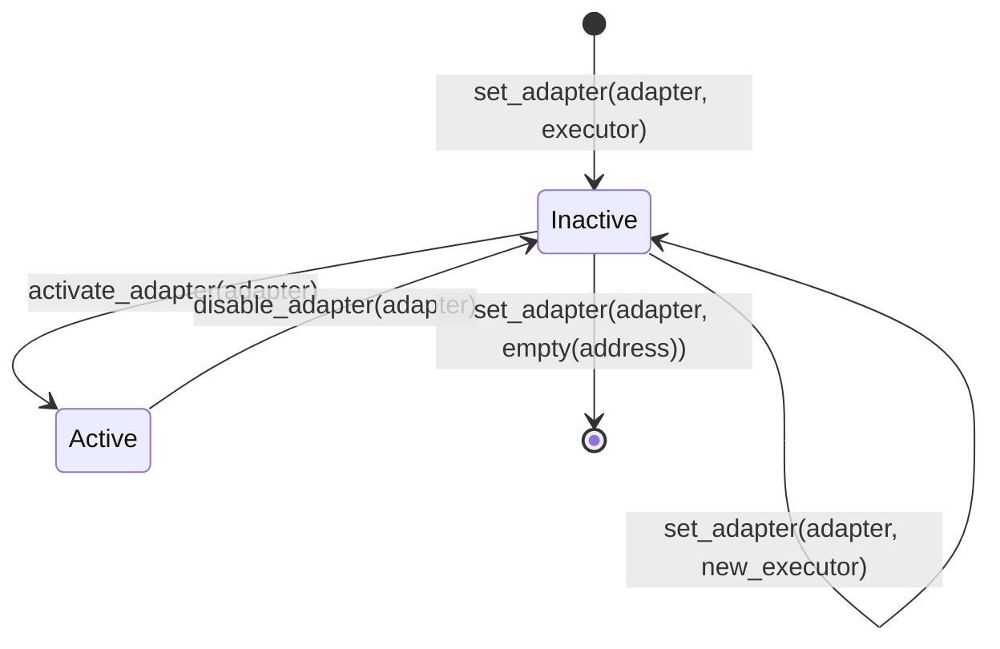

# AdapterRegistry

The `AdapterRegistry` is the list of external settlement adapters that a [`DutchAuctionBurner`](./dutch-auction-burner.md) may route orders to. Each entry stores an **adapter** (the contract that validates orders for one settlement protocol, e.g. [`CowAdapter`](./cow-adapter.md)), its **executor** (the protocol contract that pulls the sold tokens from the burner, e.g. CoW Protocol's vault relayer) and an activation flag.

The burner reads the registry live on every signature check and allowance sync. An adapter only receives orders while it is active, and auctions only grant token allowances to an executor while at least one active adapter uses it. The registry holds no tokens, calls no external protocols and never runs an adapter's code.

:::vyper[`AdapterRegistry.vy`]

The source code for the `AdapterRegistry.vy` contract can be found on [GitHub](https://github.com/curvefi/curve-burners/blob/feat/dutch-auction/contracts/burners/adapters/AdapterRegistry.vy). The contract is written in [Vyper](https://vyperlang.org/) version `0.5.0b1` for the `cancun` EVM version. Roles are handled by the shared [`roles.vy`](https://github.com/curvefi/curve-burners/blob/feat/dutch-auction/contracts/utils/roles.vy) module.

Each `DutchAuctionBurner` reads its own registry, set at deployment:

- :logos-ethereum: Ethereum: [`0xea982B86c6b8a4DFB10eA128522567F02794B9B3`](https://etherscan.io/address/0xea982B86c6b8a4DFB10eA128522567F02794B9B3)
- :logos-gnosis: Gnosis: [`0xF072011852521D27543e44B19eFc32868eD09ebE`](https://gnosisscan.io/address/0xF072011852521D27543e44B19eFc32868eD09ebE)
- :logos-polygon: Polygon: [`0xEb4b6A015AB06aad3C9EEDd3b8cf6116bF484961`](https://polygonscan.com/address/0xEb4b6A015AB06aad3C9EEDd3b8cf6116bF484961)
- :logos-fraxtal: Fraxtal: [`0x0fE9C419aC0bE5cfCcAaCe266fE7d64202DA7eD3`](https://fraxscan.com/address/0x0fE9C419aC0bE5cfCcAaCe266fE7d64202DA7eD3)
- :logos-arbitrum: Arbitrum: [`0x02D5F6a7c021C17224e2cc772eCDFf5F06FF3cE2`](https://arbiscan.io/address/0x02D5F6a7c021C17224e2cc772eCDFf5F06FF3cE2)
- :logos-base: Base: [`0xc10ddf15512462f02156f2a3F4898BfF6002699c`](https://basescan.org/address/0xc10ddf15512462f02156f2a3F4898BfF6002699c)

<ContractABI>

```json
[{"name":"AdapterSet","inputs":[{"name":"adapter","type":"address","indexed":true},{"name":"executor","type":"address","indexed":true}],"anonymous":false,"type":"event"},{"name":"AdapterActivated","inputs":[{"name":"adapter","type":"address","indexed":true}],"anonymous":false,"type":"event"},{"name":"AdapterDisabled","inputs":[{"name":"adapter","type":"address","indexed":true}],"anonymous":false,"type":"event"},{"name":"BadAdapter","inputs":[],"type":"error"},{"name":"UnknownAdapter","inputs":[],"type":"error"},{"name":"AlreadyActive","inputs":[],"type":"error"},{"name":"NotActive","inputs":[],"type":"error"},{"name":"BadRoleSource","inputs":[],"type":"error"},{"name":"OnlyOwner","inputs":[],"type":"error"},{"name":"OnlyOwnerOrEmergency","inputs":[],"type":"error"},{"stateMutability":"view","type":"function","name":"role_source","inputs":[],"outputs":[{"name":"","type":"address"}]},{"stateMutability":"view","type":"function","name":"owner","inputs":[],"outputs":[{"name":"","type":"address"}]},{"stateMutability":"view","type":"function","name":"emergency_owner","inputs":[],"outputs":[{"name":"","type":"address"}]},{"stateMutability":"view","type":"function","name":"get_adapter","inputs":[{"name":"_adapter","type":"address"}],"outputs":[{"name":"","type":"tuple","components":[{"name":"executor","type":"address"},{"name":"active","type":"bool"}]}]},{"stateMutability":"view","type":"function","name":"get_adapters","inputs":[],"outputs":[{"name":"","type":"address[]"}]},{"stateMutability":"view","type":"function","name":"is_executor_active","inputs":[{"name":"_executor","type":"address"}],"outputs":[{"name":"","type":"bool"}]},{"stateMutability":"nonpayable","type":"function","name":"set_adapter","inputs":[{"name":"_adapter","type":"address"},{"name":"_executor","type":"address"}],"outputs":[]},{"stateMutability":"nonpayable","type":"function","name":"activate_adapter","inputs":[{"name":"_adapter","type":"address"}],"outputs":[]},{"stateMutability":"nonpayable","type":"function","name":"disable_adapter","inputs":[{"name":"_adapter","type":"address"}],"outputs":[]},{"stateMutability":"nonpayable","type":"constructor","inputs":[{"name":"_role_source","type":"address"}],"outputs":[]}]
```

</ContractABI>

:::

---

## How It Works

### Roles

The registry stores no roles of its own. `owner` and `emergency_owner` are read live from the `FeeCollector` (the `role_source`) on every call, so they always match the `FeeCollector`'s roles.

| Action | Function | Who can call it |
| ------ | -------- | --------------- |
| Register, repoint or remove an adapter | `set_adapter` | `owner` |
| Activate an adapter | `activate_adapter` | `owner` |
| Disable an adapter | `disable_adapter` | `owner` or `emergency_owner` |

The emergency owner can switch an adapter off immediately, but can never add or re-enable one. Adapters cannot register themselves, so listing an adapter is the owner's review: an active adapter's executor gets unlimited allowances on the burner's lot tokens.

### Adapter Lifecycle



- New entries are always stored **inactive**, so registering an adapter never makes it live on its own. Nothing stops the owner from batching `set_adapter` and `activate_adapter` in one transaction.
- An **active** adapter cannot be changed with `set_adapter`; it must be disabled first. This keeps executor reference counts consistent.
- The registry holds at most 32 adapters.

### Executors and Allowances

Several adapters can share one executor. For example, every protocol in the Permit2 family pulls tokens through Permit2 itself. The registry therefore keeps a reference count per executor: `activate_adapter` increments it, `disable_adapter` decrements it, and `is_executor_active` returns `true` while it is positive.

The registry does not touch token allowances itself. Each burner's permissionless `sync_executor_approvals(executor, tokens)` reads `is_executor_active` and sets each token's allowance to unlimited or to zero. As a result:

- After activating an adapter, `sync_executor_approvals` must be called on the burner so the executor can pull lot tokens.
- Disabling an adapter stops signature routing at once, but its executor's existing allowances stay in place until `sync_executor_approvals` is called. Batch `disable_adapter` with `sync_executor_approvals(executor, tokens)` in one transaction.
- If another active adapter still uses the same executor, `is_executor_active` stays `true` after a disable and the allowances are kept, which is the intended behaviour.

---

## Adapter Catalog

### `get_adapter`
::::description[`AdapterRegistry.get_adapter(_adapter: address) -> AdapterConfig: view`]

Getter for an adapter's configuration. An unknown adapter returns a zeroed config (`executor == empty(address)`), which the burner's signature router treats as invalid.

| Input      | Type      | Description      |
| ---------- | --------- | ---------------- |
| `_adapter` | `address` | Adapter contract |

Returns: `AdapterConfig` struct consisting of `executor` (`address`), the contract that pulls sold tokens, and `active` (`bool`), whether the adapter is active.

<SourceCode>

<Tabs>
<TabItem value="AdapterRegistry.vy" label="AdapterRegistry.vy">

```vyper
configs: HashMap[address, IAdapterRegistry.AdapterConfig]

@external
@view
def get_adapter(_adapter: address) -> IAdapterRegistry.AdapterConfig:
    """
    @notice Read an adapter's config.
    @param _adapter Adapter contract.
    @return Stored config; zeroed (executor == empty(address)) when unknown.
    """
    return self.configs[_adapter]
```

</TabItem>
<TabItem value="IAdapterRegistry.vyi" label="IAdapterRegistry.vyi">

```vyper
struct AdapterConfig:
    executor: address
    active: bool
```

</TabItem>
</Tabs>

</SourceCode>

<Example>

<ContractCall
  address="0xea982B86c6b8a4DFB10eA128522567F02794B9B3"
  abi={["function get_adapter(address) view returns (address executor, bool active)"]}
  method="get_adapter"
  args={["0xbC80ef170705232A82752d87334429218d988996"]}
  labels={["_adapter"]}
  contractName="AdapterRegistry"
/>


</Example>

::::

### `get_adapters`
::::description[`AdapterRegistry.get_adapters() -> DynArray[address, MAX_ADAPTERS]: view`]

Getter for every registered adapter, active or not, in no particular order. Removing an entry swaps the last entry into its place, so indices are not stable.

Returns: registered adapter addresses (`DynArray[address, 32]`).

<SourceCode>

```vyper
# Registered adapters (executor set), in no particular order.
adapters: DynArray[address, c.MAX_ADAPTERS]

@external
@view
def get_adapters() -> DynArray[address, c.MAX_ADAPTERS]:
    """
    @notice List every registered adapter, active or not.
    @return Registered adapter addresses, in no particular order.
    """
    return self.adapters
```

</SourceCode>

<Example>

<ContractCall
  address="0xea982B86c6b8a4DFB10eA128522567F02794B9B3"
  abi={["function get_adapters() view returns (address[])"]}
  method="get_adapters"
  contractName="AdapterRegistry"
/>


</Example>

::::

### `is_executor_active`
::::description[`AdapterRegistry.is_executor_active(_executor: address) -> bool: view`]

Getter for whether at least one active adapter uses an executor. Burners keep their allowances toward an executor while this returns `true`, via `sync_executor_approvals`.

| Input       | Type      | Description       |
| ----------- | --------- | ----------------- |
| `_executor` | `address` | Executor contract |

Returns: `true` while at least one active adapter references the executor (`bool`).

<SourceCode>

```vyper
# Active adapters per executor. Several adapters can share one executor (every
# permit2-family protocol pulls through Permit2 itself); auctions approve an
# executor while its count is positive.
executor_refcount: HashMap[address, uint256]

@external
@view
def is_executor_active(_executor: address) -> bool:
    """
    @notice Whether an active adapter references the executor; auctions keep
            their allowances toward it while this holds.
    @param _executor Executor contract.
    @return True while at least one active adapter references it.
    """
    return self.executor_refcount[_executor] > 0
```

</SourceCode>

<Example>

<ContractCall
  address="0xea982B86c6b8a4DFB10eA128522567F02794B9B3"
  abi={["function is_executor_active(address) view returns (bool)"]}
  method="is_executor_active"
  args={["0xC92E8bdf79f0507f65a392b0ab4667716BFE0110"]}
  labels={["_executor"]}
  contractName="AdapterRegistry"
/>

</Example>

::::

---

## Adapter Management

### `set_adapter`
::::description[`AdapterRegistry.set_adapter(_adapter: address, _executor: address)`]

:::guard[Guarded Method]
This function can only be called by the `owner` of the registry, which is read live from the `FeeCollector`. So adding a settlement rail is in the hands of whoever owns the `FeeCollector`.
:::

Function to register an adapter, point an inactive adapter at a new executor, or remove an adapter. The entry is always stored inactive; `activate_adapter` is a separate step. Passing `empty(address)` as `_executor` removes the adapter from `get_adapters`, and it then reads as unknown. Reverts with `AlreadyActive` if the adapter is currently active (disable it first), and with `BadAdapter` for the zero address. Registering a 33rd adapter reverts.

| Input       | Type      | Description                                                         |
| ----------- | --------- | ------------------------------------------------------------------- |
| `_adapter`  | `address` | Adapter contract                                                    |
| `_executor` | `address` | Protocol contract that pulls sold tokens; `empty(address)` removes the entry |

Emits: `AdapterSet` event.

<SourceCode>

<Tabs>
<TabItem value="AdapterRegistry.vy" label="AdapterRegistry.vy">

```vyper
event AdapterSet:
    adapter: indexed(address)
    executor: indexed(address)

@external
def set_adapter(_adapter: address, _executor: address):
    """
    @notice Register an adapter, repoint an inactive one at a new executor,
            or remove it (executor == empty(address) reads as unknown and
            drops it from get_adapters). Entries are stored inactive:
            activation is a separate owner step, and an active adapter must
            be disabled first so executor references stay consistent.
    @param _adapter Adapter contract.
    @param _executor Protocol contract that pulls sold tokens; the approval
           target auctions grant while the adapter is active. Zero removes
           the entry.
    """
    roles._check_owner()
    assert _adapter != empty(address), BadAdapter()
    assert not self.configs[_adapter].active, AlreadyActive()

    if _executor == empty(address):
        self._remove_listing(_adapter)
    elif self.configs[_adapter].executor == empty(address):
        self.adapters.append(_adapter)  # dev: too many adapters
    self.configs[_adapter] = IAdapterRegistry.AdapterConfig(executor=_executor, active=False)
    log AdapterSet(adapter=_adapter, executor=_executor)

@internal
def _remove_listing(_adapter: address):
    # Swap-remove: order is not part of the listing's contract.
    for i: uint256 in range(len(self.adapters), bound=c.MAX_ADAPTERS):
        if self.adapters[i] == _adapter:
            self.adapters[i] = self.adapters[len(self.adapters) - 1]
            self.adapters.pop()
            break
```

</TabItem>
<TabItem value="roles.vy" label="roles.vy">

```vyper
role_source: public(immutable(RoleSource))

@internal
@view
def _owner() -> address:
    return staticcall self.role_source.owner()

@internal
@view
def _check_owner():
    assert msg.sender == self._owner(), OnlyOwner()
```

</TabItem>
</Tabs>

</SourceCode>

<Example>

```shell
>>> AdapterRegistry.set_adapter(cow_adapter, cow_adapter.vault_relayer())
```

</Example>

::::

### `activate_adapter`
::::description[`AdapterRegistry.activate_adapter(_adapter: address)`]

:::guard[Guarded Method]
This function can only be called by the `owner` of the registry, which is read live from the `FeeCollector`. The emergency owner cannot activate adapters.
:::

Function to activate a registered adapter and add a reference to its executor. From then on, burners route signatures prefixed with this adapter's address to it, and `is_executor_active` returns `true` for its executor. Burner allowances only follow once `sync_executor_approvals` is called on each burner. Reverts with `UnknownAdapter` if the adapter is not registered and with `AlreadyActive` if it is already active.

| Input      | Type      | Description                                      |
| ---------- | --------- | ------------------------------------------------ |
| `_adapter` | `address` | Adapter to activate; must be registered and inactive |

Emits: `AdapterActivated` event.

<SourceCode>

<Tabs>
<TabItem value="AdapterRegistry.vy" label="AdapterRegistry.vy">

```vyper
event AdapterActivated:
    adapter: indexed(address)

@external
def activate_adapter(_adapter: address):
    """
    @notice Activate a registered adapter and reference its executor;
            auction allowances follow through their sync_executor_approvals.
    @param _adapter Adapter to activate; must exist and be inactive.
    """
    roles._check_owner()
    config: IAdapterRegistry.AdapterConfig = self.configs[_adapter]
    assert config.executor != empty(address), UnknownAdapter()
    assert not config.active, AlreadyActive()

    self.configs[_adapter].active = True
    self.executor_refcount[config.executor] += 1
    log AdapterActivated(adapter=_adapter)
```

</TabItem>
<TabItem value="roles.vy" label="roles.vy">

```vyper
@internal
@view
def _check_owner():
    assert msg.sender == self._owner(), OnlyOwner()
```

</TabItem>
</Tabs>

</SourceCode>

<Example>

```shell
>>> AdapterRegistry.activate_adapter(cow_adapter)
>>> DutchAuctionBurner.sync_executor_approvals(cow_adapter.vault_relayer(), lot_tokens)
```

</Example>

::::

### `disable_adapter`
::::description[`AdapterRegistry.disable_adapter(_adapter: address)`]

:::guard[Guarded Method]
This function can be called by the `owner` or the `emergency_owner` of the registry, both read live from the `FeeCollector`. It is the only function the emergency owner can call, so an adapter can be switched off quickly without the emergency owner being able to add one.
:::

Function to disable an active adapter and release its executor reference. Every burner reading this registry stops routing signatures to the adapter immediately. Native `take` on the burners is not affected. Token allowances are not touched: batch this call with each burner's `sync_executor_approvals(executor, tokens)`. Reverts with `NotActive` if the adapter is not active.

| Input      | Type      | Description                         |
| ---------- | --------- | ----------------------------------- |
| `_adapter` | `address` | Adapter to disable; must be active  |

Emits: `AdapterDisabled` event.

<SourceCode>

<Tabs>
<TabItem value="AdapterRegistry.vy" label="AdapterRegistry.vy">

```vyper
event AdapterDisabled:
    adapter: indexed(address)

@external
def disable_adapter(_adapter: address):
    """
    @notice Disable an active adapter and release its executor reference.
            Faster than activation on purpose: the emergency owner can kill an
            adapter without being able to add one.
    @dev Does not touch auction allowances: batch with each auction's
         sync_executor_approvals once the executor is no longer active.
    @param _adapter Adapter to disable; must be active.
    """
    roles._check_owner_or_emergency()
    config: IAdapterRegistry.AdapterConfig = self.configs[_adapter]
    assert config.active, NotActive()

    self.configs[_adapter].active = False
    self.executor_refcount[config.executor] -= 1
    log AdapterDisabled(adapter=_adapter)
```

</TabItem>
<TabItem value="roles.vy" label="roles.vy">

```vyper
@internal
@view
def _emergency_owner() -> address:
    return staticcall self.role_source.emergency_owner()

@internal
@view
def _check_owner_or_emergency():
    assert msg.sender in [self._owner(), self._emergency_owner()], OnlyOwnerOrEmergency()
```

</TabItem>
</Tabs>

</SourceCode>

<Example>

```shell
# one transaction (e.g. via a multisig batch)
>>> AdapterRegistry.disable_adapter(cow_adapter)
>>> DutchAuctionBurner.sync_executor_approvals(cow_adapter.vault_relayer(), lot_tokens)
```

</Example>

::::

---

## Contract Ownership

The registry has no ownership functions of its own. Both roles are read live from the `role_source` (the `FeeCollector`), so they are changed there with `FeeCollector.set_owner` and `FeeCollector.set_emergency_owner`.

### `owner`
::::description[`AdapterRegistry.owner() -> address: view`]

Getter for the owner, read live from `role_source.owner()`.

Returns: owner (`address`).

<SourceCode>

<Tabs>
<TabItem value="AdapterRegistry.vy" label="AdapterRegistry.vy">

```vyper
initializes: roles
exports: (
    roles.role_source,
    roles.owner,
    roles.emergency_owner,
)
```

</TabItem>
<TabItem value="roles.vy" label="roles.vy">

```vyper
@external
@view
def owner() -> address:
    """
    @notice Governance owner.
    @return Owner read live from the role source.
    """
    return self._owner()

@internal
@view
def _owner() -> address:
    return staticcall self.role_source.owner()
```

</TabItem>
</Tabs>

</SourceCode>

<Example>

<ContractCall
  address="0xea982B86c6b8a4DFB10eA128522567F02794B9B3"
  abi={["function owner() view returns (address)"]}
  method="owner"
  contractName="AdapterRegistry"
/>

</Example>

::::

### `emergency_owner`
::::description[`AdapterRegistry.emergency_owner() -> address: view`]

Getter for the emergency owner, read live from `role_source.emergency_owner()`. The emergency owner can only call `disable_adapter`.

Returns: emergency owner (`address`).

<SourceCode>

<Tabs>
<TabItem value="AdapterRegistry.vy" label="AdapterRegistry.vy">

```vyper
initializes: roles
exports: (
    roles.role_source,
    roles.owner,
    roles.emergency_owner,
)
```

</TabItem>
<TabItem value="roles.vy" label="roles.vy">

```vyper
@external
@view
def emergency_owner() -> address:
    """
    @notice Emergency role owner.
    @return Emergency owner read live from the role source.
    """
    return self._emergency_owner()

@internal
@view
def _emergency_owner() -> address:
    return staticcall self.role_source.emergency_owner()
```

</TabItem>
</Tabs>

</SourceCode>

<Example>

<ContractCall
  address="0xea982B86c6b8a4DFB10eA128522567F02794B9B3"
  abi={["function emergency_owner() view returns (address)"]}
  method="emergency_owner"
  contractName="AdapterRegistry"
/>

</Example>

::::

### `role_source`
::::description[`AdapterRegistry.role_source() -> RoleSource: view`]

Getter for the contract the roles are read from, set at deployment. On every deployment this is the chain's `FeeCollector`.

Returns: role source (`RoleSource`).

<SourceCode>

<Tabs>
<TabItem value="AdapterRegistry.vy" label="AdapterRegistry.vy">

```vyper
@deploy
def __init__(_role_source: roles.RoleSource):
    """
    @notice Pin the role source the registry reads its owners from.
    @param _role_source Contract exposing owner() and emergency_owner() views
           (the FeeCollector); must answer owner() with a nonzero address.
    """
    roles.__init__(_role_source)
```

</TabItem>
<TabItem value="roles.vy" label="roles.vy">

```vyper
role_source: public(immutable(RoleSource))

@deploy
def __init__(_role_source: RoleSource):
    assert staticcall _role_source.owner() != empty(address), BadRoleSource()
    self.role_source = _role_source
```

</TabItem>
</Tabs>

</SourceCode>

<Example>

<ContractCall
  address="0xea982B86c6b8a4DFB10eA128522567F02794B9B3"
  abi={["function role_source() view returns (address)"]}
  method="role_source"
  contractName="AdapterRegistry"
/>

</Example>

::::
