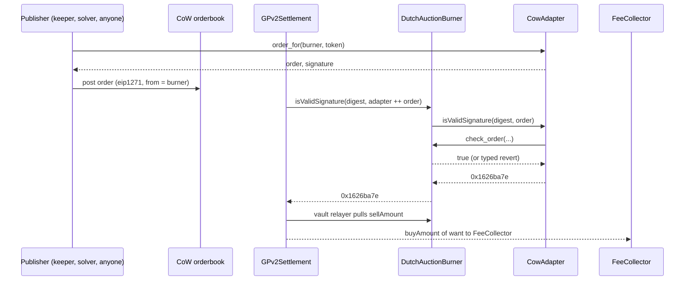

# CowAdapter

The `CowAdapter` lets [CoW Protocol](https://docs.cow.fi/) settle orders that sell lots of a [`DutchAuctionBurner`](./dutch-auction-burner.md). The burner is the owner of these orders and signs them with ERC-1271. When CoW Protocol's `GPv2Settlement` asks the burner to validate an order, the burner forwards the order to this adapter. The adapter checks that the order matches the signed digest and follows a fixed format, then lets the burner price it against its live auction curve through `check_order`.

The adapter is stateless and immutable. It holds no funds and receives no allowances: the burner approves the CoW vault relayer (the adapter's executor in the [`AdapterRegistry`](./adapter-registry.md)), which pulls the sold tokens during settlement.

:::vyper[`CowAdapter.vy`]

The source code for the `CowAdapter.vy` contract can be found on [GitHub](https://github.com/curvefi/curve-burners/blob/feat/dutch-auction/contracts/burners/adapters/cow/CowAdapter.vy). The contract is written in [Vyper](https://vyperlang.org/) version `0.5.0b1` for the `cancun` EVM version. The GPv2 order type and digest come from the [`gpv2.vy`](https://github.com/curvefi/curve-burners/blob/feat/dutch-auction/contracts/burners/adapters/cow/gpv2.vy) module.

The contract is deployed and active in the registry on:

- :logos-gnosis: Gnosis: [`0x2F810660d6C81F3d710d966aFb55e0E75549D4fa`](https://gnosisscan.io/address/0x2F810660d6C81F3d710d966aFb55e0E75549D4fa)
- :logos-polygon: Polygon: [`0x54322A6d2D1c96e847c22b2e519BbF90Cc8e8f98`](https://polygonscan.com/address/0x54322A6d2D1c96e847c22b2e519BbF90Cc8e8f98)

On Ethereum, Fraxtal, Arbitrum and Base no adapter is registered, so the burners there can only be bought from with a native `take`.

<ContractABI>

```json
[{"name":"BadSettlement","inputs":[],"type":"error"},{"name":"BadDomainSeparator","inputs":[],"type":"error"},{"name":"BadVaultRelayer","inputs":[],"type":"error"},{"name":"NothingToSell","inputs":[],"type":"error"},{"name":"OrderNotValid","inputs":[{"name":"reason","type":"string"}],"type":"error"},{"stateMutability":"view","type":"function","name":"order_for","inputs":[{"name":"_auction","type":"address"},{"name":"_token","type":"address"}],"outputs":[{"name":"","type":"tuple","components":[{"name":"sellToken","type":"address"},{"name":"buyToken","type":"address"},{"name":"receiver","type":"address"},{"name":"sellAmount","type":"uint256"},{"name":"buyAmount","type":"uint256"},{"name":"validTo","type":"uint32"},{"name":"appData","type":"bytes32"},{"name":"feeAmount","type":"uint256"},{"name":"kind","type":"bytes32"},{"name":"partiallyFillable","type":"bool"},{"name":"sellTokenBalance","type":"bytes32"},{"name":"buyTokenBalance","type":"bytes32"}]},{"name":"","type":"bytes"}]},{"stateMutability":"view","type":"function","name":"order_for","inputs":[{"name":"_auction","type":"address"},{"name":"_token","type":"address"},{"name":"_sell_amount","type":"uint256"}],"outputs":[{"name":"","type":"tuple","components":[{"name":"sellToken","type":"address"},{"name":"buyToken","type":"address"},{"name":"receiver","type":"address"},{"name":"sellAmount","type":"uint256"},{"name":"buyAmount","type":"uint256"},{"name":"validTo","type":"uint32"},{"name":"appData","type":"bytes32"},{"name":"feeAmount","type":"uint256"},{"name":"kind","type":"bytes32"},{"name":"partiallyFillable","type":"bool"},{"name":"sellTokenBalance","type":"bytes32"},{"name":"buyTokenBalance","type":"bytes32"}]},{"name":"","type":"bytes"}]},{"stateMutability":"view","type":"function","name":"isValidSignature","inputs":[{"name":"_hash","type":"bytes32"},{"name":"_signature","type":"bytes"}],"outputs":[{"name":"","type":"bytes4"}]},{"stateMutability":"view","type":"function","name":"ADAPTER_VERSION","inputs":[],"outputs":[{"name":"","type":"string"}]},{"stateMutability":"view","type":"function","name":"settlement","inputs":[],"outputs":[{"name":"","type":"address"}]},{"stateMutability":"view","type":"function","name":"domain_separator","inputs":[],"outputs":[{"name":"","type":"bytes32"}]},{"stateMutability":"view","type":"function","name":"vault_relayer","inputs":[],"outputs":[{"name":"","type":"address"}]},{"stateMutability":"view","type":"function","name":"app_data","inputs":[],"outputs":[{"name":"","type":"bytes32"}]},{"stateMutability":"nonpayable","type":"constructor","inputs":[{"name":"_settlement","type":"address"},{"name":"_app_data","type":"bytes32"}],"outputs":[]}]
```

</ContractABI>

:::

---

## How It Works

### Settlement Flow



1. A publisher calls `order_for` to build an order for a live lot. Anyone can publish: the signature carries no authority, because every fill is checked against the live curve at settlement time.
2. The order is posted to the CoW orderbook with signing scheme `eip1271`, `from` set to the burner, and the signature `CowAdapter address (20 bytes) ++ abi.encode(order)`.
3. At settlement, `GPv2Settlement` calls the burner's `isValidSignature`. The burner strips the 20-byte adapter prefix, checks that the adapter is active in the registry, and forwards the bare order to `CowAdapter.isValidSignature`.
4. The adapter validates the order and delegates pricing to the calling burner's `check_order`.

`order_for` prices the order at the current block. Because the curve only decays, an earlier order stays valid as a standing ask above the curve. A publisher re-posts orders as the price falls to keep the ask close to the curve.

### Order Requirements

`isValidSignature` accepts an order only if all of the following hold. Protocol checks revert with `OrderNotValid(reason)`; the economic checks are `check_order`'s typed errors, passed through unchanged.

| Check | Requirement | Revert |
| ----- | ----------- | ------ |
| Encoding | payload is exactly one ABI-encoded `GPv2Order` (384 bytes) | `OrderNotValid("NonCanonical")` |
| Digest | EIP-712 digest of the order equals the hash being validated | `OrderNotValid("InvalidHash")` |
| `appData` | equals the adapter's `app_data` | `OrderNotValid("BadAppData")` |
| Flags | `feeAmount == 0`, `kind == sell`, `partiallyFillable == true` | `OrderNotValid("BadOrderFlags")` |
| Balances | `sellTokenBalance` and `buyTokenBalance` are both `erc20` | `OrderNotValid("BadBalanceMode")` |
| Economics | `buyToken` is `want`, `receiver` is the `FeeCollector`, lot is active, `sellAmount <= initial_amount`, `validTo <= window end`, `buyAmount >=` live quote | `check_order` errors (`BadBuyToken`, `BadReceiver`, `LotInactive`, `NothingAvailable`, `BadSellAmount`, `BadValidTo`, `BadBuyAmount`) |

Since every check reverts with a specific error, a single `eth_call` to the burner's `isValidSignature` tells a publisher exactly why an order cannot be filled.

---

## Publishing Orders

### `order_for`
::::description[`CowAdapter.order_for(_auction: IDutchAuction, _token: address, _sell_amount: uint256 = 0) -> (GPv2Order, Bytes[404]): view`]

Function to build the order and signature a publisher posts to the CoW orderbook for a live lot. The buy amount is the auction's `getAmountNeeded` quote at the current block, `validTo` is the end of the lot's window, and the receiver is the auction's `receiver` (the `FeeCollector`). Post it with `from` set to the auction and the returned bytes as the `eip1271` signature. Reverts with `NothingToSell` if nothing is available.

| Input          | Type            | Description                                         |
| -------------- | --------------- | --------------------------------------------------- |
| `_auction`     | `IDutchAuction` | Auction (`DutchAuctionBurner`) selling the lot      |
| `_token`       | `address`       | Lot token to sell                                   |
| `_sell_amount` | `uint256`       | Amount to sell; `0` (default) sells everything available |

Returns: the `GPv2Order` struct and the signature `adapter_address ++ abi.encode(order)` (`Bytes[404]`).

<SourceCode>

<Tabs>
<TabItem value="CowAdapter.vy" label="CowAdapter.vy">

```vyper
SIGNATURE_LEN: constant(uint256) = 20 + gpv2.ENCODED_ORDER_LEN

@external
@view
def order_for(
    _auction: IDutchAuction, _token: address, _sell_amount: uint256 = 0
) -> (gpv2.GPv2Order, Bytes[SIGNATURE_LEN]):
    """
    @notice Build the order a publisher posts to the CoW orderbook for a live
            lot, together with its eip1271 signature for the auction.
    @dev Priced at the current block: the buy amount is the auction's quote
         now, so the order stays valid while the curve decays below it (a
         standing ask) and a publisher re-posts as the price falls. Validity
         ends with the lot window. Post with `from` = the auction and the
         returned bytes as the signature; anyone may do so.
    @param _auction Auction (DutchAuctionBurner) selling the lot.
    @param _token Lot token to sell.
    @param _sell_amount Amount to sell; 0 sells everything available.
    @return The GPv2 order and `this_adapter ++ abi_encode(order)`.
    """
    sell_amount: uint256 = _sell_amount
    if sell_amount == 0:
        sell_amount = staticcall _auction.available(_token)
    assert sell_amount > 0, NothingToSell()
    lot_start: uint256 = 0
    lot_end: uint256 = 0
    lot_start, lot_end = staticcall _auction.window(_token)

    order: gpv2.GPv2Order = gpv2.GPv2Order(
        sellToken=_token,
        buyToken=(staticcall _auction.want()).address,
        receiver=staticcall _auction.receiver(),
        sellAmount=sell_amount,
        buyAmount=staticcall _auction.getAmountNeeded(_token, sell_amount),
        # validTo is inclusive on the CoW side; check_order rejects at lot_end
        # anyway (LotInactive), so nothing settles past the window.
        validTo=convert(lot_end, uint32),
        appData=self.app_data,
        feeAmount=0,
        kind=gpv2.SELL_KIND,
        partiallyFillable=True,
        sellTokenBalance=gpv2.TOKEN_BALANCE,
        buyTokenBalance=gpv2.TOKEN_BALANCE,
    )
    return order, concat(convert(self, bytes20), abi_encode(order))
```

</TabItem>
<TabItem value="gpv2.vy" label="gpv2.vy">

```vyper
struct GPv2Order:
    sellToken: address
    buyToken: address
    receiver: address
    sellAmount: uint256
    buyAmount: uint256
    validTo: uint32
    appData: bytes32
    feeAmount: uint256
    kind: bytes32
    partiallyFillable: bool
    sellTokenBalance: bytes32
    buyTokenBalance: bytes32

# Every field is a static ABI type, so the struct encodes to 12 words.
ENCODED_ORDER_LEN: constant(uint256) = 12 * 32

# keccak256("sell") = 0xf3b277728b3fee749481eb3e0b3b48980dbbab78658fc419025cb16eee346775
SELL_KIND: constant(bytes32) = keccak256("sell")
# keccak256("erc20") = 0x5a28e9363bb942b639270062aa6bb295f434bcdfc42c97267bf003f272060dc9
TOKEN_BALANCE: constant(bytes32) = keccak256("erc20")
```

</TabItem>
</Tabs>

</SourceCode>

<Example>

```shell
>>> order, signature = CowAdapter.order_for("0x3Fe661204F04ce0793D40FeC90aEEd6539dfa788", "0xc2132D05D31c914a87C6611C10748AEb04B58e8F")   # Polygon
>>> order
('0xc2132D05D31c914a87C6611C10748AEb04B58e8F', '0x3c499c542cEF5E3811e1192ce70d8cC03d5c3359', '0xf03591c62A57F71f5EbD774453db57ADCC299a6a', 1523450012, 1524078562, 1795564800, '0xcf261e14317b684444265a64b2c53556223d665a7f424a42f4511e6e3456c2cf', 0, '0xf3b277728b3fee749481eb3e0b3b48980dbbab78658fc419025cb16eee346775', True, '0x5a28e9363bb942b639270062aa6bb295f434bcdfc42c97267bf003f272060dc9', '0x5a28e9363bb942b639270062aa6bb295f434bcdfc42c97267bf003f272060dc9')
```

</Example>

::::

---

## Settlement

### `isValidSignature`
::::description[`CowAdapter.isValidSignature(_hash: bytes32, _signature: Bytes[384]) -> bytes4: view`]

Function called by the burner's ERC-1271 router to validate a CoW order. `_signature` is the bare ABI-encoded `GPv2Order`; the burner has already stripped the 20-byte adapter prefix. The adapter checks the encoding, the EIP-712 digest, `appData`, the order flags and the balance modes, then calls `check_order` on the calling burner (`msg.sender`) to price the order against the live curve. See [Order Requirements](#order-requirements) for every check and its revert.

The adapter does not care which burner calls it: all economic decisions are made by the caller's `check_order`. Calling the adapter directly therefore proves nothing about any auction; validate through the burner's `isValidSignature` instead.

| Input        | Type         | Description                                           |
| ------------ | ------------ | ----------------------------------------------------- |
| `_hash`      | `bytes32`    | GPv2 order digest the settlement is verifying         |
| `_signature` | `Bytes[384]` | ABI-encoded `GPv2Order`, adapter prefix already stripped |

Returns: ERC-1271 magic value `0x1626ba7e` for an order that can be filled; anything else reverts (`bytes4`).

<SourceCode>

<Tabs>
<TabItem value="CowAdapter.vy" label="CowAdapter.vy">

```vyper
@external
@view
def isValidSignature(_hash: bytes32, _signature: Bytes[gpv2.ENCODED_ORDER_LEN]) -> bytes4:
    """
    @notice Validate a GPv2 digest against the calling auction's live lot
            economics.
    ...
    """
    assert len(_signature) == gpv2.ENCODED_ORDER_LEN, gpv2.OrderNotValid(reason="NonCanonical")
    order: gpv2.GPv2Order = abi_decode(_signature, gpv2.GPv2Order)

    assert gpv2._order_digest(order, self.domain_separator) == _hash, (
        gpv2.OrderNotValid(reason="InvalidHash")
    )
    assert order.appData == self.app_data, gpv2.OrderNotValid(reason="BadAppData")
    assert (
        order.feeAmount == 0 and order.kind == gpv2.SELL_KIND and order.partiallyFillable
    ), gpv2.OrderNotValid(reason="BadOrderFlags")
    assert (
        order.sellTokenBalance == gpv2.TOKEN_BALANCE and order.buyTokenBalance == gpv2.TOKEN_BALANCE
    ), gpv2.OrderNotValid(reason="BadBalanceMode")

    # The shared economic check: the calling auction prices the fill against
    # its live curve and reverts with its own typed error on failure.
    assert staticcall IDutchAuction(msg.sender).check_order(
        order.sellToken,
        order.buyToken,
        order.receiver,
        order.sellAmount,
        order.buyAmount,
        convert(order.validTo, uint256),
    )
    return c.ERC1271_MAGIC_VALUE
```

</TabItem>
<TabItem value="gpv2.vy" label="gpv2.vy">

```vyper
error OrderNotValid:
    reason: String[32]

GPV2_ORDER_TYPE_HASH: constant(bytes32) = keccak256(
    "Order(address sellToken,address buyToken,address receiver,uint256 sellAmount,"
    "uint256 buyAmount,uint32 validTo,bytes32 appData,uint256 feeAmount,string kind,"
    "bool partiallyFillable,string sellTokenBalance,string buyTokenBalance)"
)  # 0xd5a25ba2e97094ad7d83dc28a6572da797d6b3e7fc6663bd93efb789fc17e489

@internal
@pure
def _order_digest(_order: GPv2Order, _domain_separator: bytes32) -> bytes32:
    # All order fields are static types, so abi_encode(struct) is exactly the
    # word-per-field layout hashStruct expects.
    struct_hash: bytes32 = keccak256(abi_encode(GPV2_ORDER_TYPE_HASH, _order))
    return keccak256(concat(b"\x19\x01", _domain_separator, struct_hash))
```

</TabItem>
<TabItem value="dutch_auction.vy" label="dutch_auction.vy">

```vyper
@external
@view
def check_order(
    _sell_token: address,
    _buy_token: address,
    _receiver: address,
    _sell_amount: uint256,
    _min_buy_amount: uint256,
    _valid_to: uint256,
) -> bool:
    token: IERC20 = IERC20(_sell_token)
    lot: IDutchAuction.Lot = self.lots[token]
    assert _buy_token == self.want.address, BadBuyToken()
    assert _receiver == self.receiver, BadReceiver()
    assert self._is_active(token, lot, block.timestamp), LotInactive()
    assert self._available_unchecked(token, lot) > 0, NothingAvailable()
    assert 0 < _sell_amount and _sell_amount <= lot.initial_amount, BadSellAmount()
    lot_start: uint256 = 0
    lot_end: uint256 = 0
    lot_start, lot_end = self._window(token, lot.staged_at)
    assert block.timestamp <= _valid_to and _valid_to <= lot_end, BadValidTo()
    assert _min_buy_amount >= self._quote_unchecked(token, _sell_amount, block.timestamp), (
        BadBuyAmount()
    )
    return True
```

</TabItem>
</Tabs>

</SourceCode>

<Example>

```shell
# validate through the burner, which strips the prefix and calls the adapter
>>> DutchAuctionBurner.isValidSignature(order_digest, signature)
0x1626ba7e
```

</Example>

::::

---

## CoW Protocol Wiring

All four values are set at deployment and cannot change. A new `GPv2Settlement` would need a new adapter and a new registry entry.

### `settlement`
::::description[`CowAdapter.settlement() -> address: view`]

Getter for the chain's canonical CoW Protocol `GPv2Settlement` contract.

Returns: `GPv2Settlement` (`address`).

<SourceCode>

```vyper
settlement: public(immutable(address))

@deploy
def __init__(_settlement: address, _app_data: bytes32):
    """
    @notice Pin the settlement, its EIP-712 domain, and the order appData.
    @param _settlement Canonical GPv2 settlement contract of this chain.
    @param _app_data appData hash every order published for this adapter uses.
    """
    assert _settlement != empty(address), BadSettlement()
    domain: bytes32 = staticcall Settlement(_settlement).domainSeparator()
    relayer: address = staticcall Settlement(_settlement).vaultRelayer()
    assert domain != empty(bytes32), BadDomainSeparator()
    assert relayer != empty(address), BadVaultRelayer()

    self.settlement = _settlement
    self.domain_separator = domain
    self.vault_relayer = relayer
    self.app_data = _app_data
```

</SourceCode>

<Example>

```shell
>>> CowAdapter.settlement()
'0x9008D19f58AAbD9eD0D60971565AA8510560ab41'
```

</Example>

::::

### `domain_separator`
::::description[`CowAdapter.domain_separator() -> bytes32: view`]

Getter for the EIP-712 domain separator of the settlement contract, read from `GPv2Settlement.domainSeparator()` at deployment. It is used to compute order digests and differs per chain.

Returns: domain separator (`bytes32`).

<SourceCode>

```vyper
domain_separator: public(immutable(bytes32))
```

</SourceCode>

<Example>

```shell
>>> CowAdapter.domain_separator()   # Polygon
'0x132e0e39721b0cb53216fc42764f69c300d4d21e0caf24e0713b1e3e11120dc2'
```

</Example>

::::

### `vault_relayer`
::::description[`CowAdapter.vault_relayer() -> address: view`]

Getter for CoW Protocol's vault relayer, read from `GPv2Settlement.vaultRelayer()` at deployment. This is the contract that pulls sold tokens from the burner, so it is registered as the adapter's executor in the `AdapterRegistry` and receives the burner's allowances through `sync_executor_approvals`.

Returns: vault relayer (`address`).

<SourceCode>

```vyper
vault_relayer: public(immutable(address))
```

</SourceCode>

<Example>

```shell
>>> CowAdapter.vault_relayer()
'0xC92E8bdf79f0507f65a392b0ab4667716BFE0110'
```

</Example>

::::

### `app_data`
::::description[`CowAdapter.app_data() -> bytes32: view`]

Getter for the `appData` hash every order for this adapter must carry. `order_for` sets it, and `isValidSignature` rejects any other value with `OrderNotValid("BadAppData")`.

Returns: `appData` hash (`bytes32`).

<SourceCode>

```vyper
# The appData every published order must carry.
app_data: public(immutable(bytes32))
```

</SourceCode>

<Example>

```shell
>>> CowAdapter.app_data()
'0xcf261e14317b684444265a64b2c53556223d665a7f424a42f4511e6e3456c2cf'
```

</Example>

::::

---

## Other Methods

### `ADAPTER_VERSION`
::::description[`CowAdapter.ADAPTER_VERSION() -> String[20]: view`]

Getter for the adapter version.

Returns: version (`String[20]`).

<SourceCode>

```vyper
ADAPTER_VERSION: public(constant(String[20])) = "CowAdapter"
```

</SourceCode>

<Example>

```shell
>>> CowAdapter.ADAPTER_VERSION()
'CowAdapter'
```

</Example>

::::
