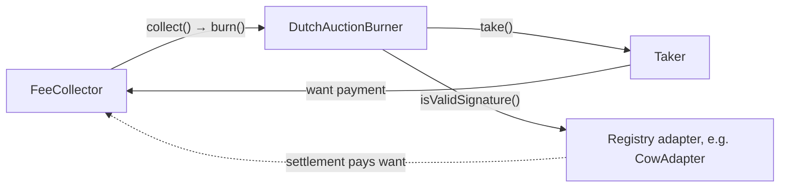

# DutchAuctionBurner

The `DutchAuctionBurner` is a burner for the `FeeCollector` that sells collected fee tokens into the fee target token through a weekly Dutch auction. Each week, during the `FeeCollector`'s COLLECT epoch, every fee token's balance is staged as a **lot**. During the following EXCHANGE epoch, the price of each lot decays exponentially from `start_total` to `floor_total`, and anyone can buy from it, either directly via `take` or through an external settlement protocol (such as CoW Protocol) that reaches the burner through registry-managed adapters and ERC-1271 signatures. All proceeds go straight to the `FeeCollector`.

:::vyper[`DutchAuctionBurner.vy`]

The source code for the `DutchAuctionBurner.vy` contract can be found on [GitHub](https://github.com/curvefi/curve-burners/blob/feat/dutch-auction/contracts/burners/DutchAuctionBurner.vy). The contract is written in [Vyper](https://vyperlang.org/) version `0.5.0b1` and compiled with the experimental Venom code generator for the `cancun` EVM version.

The contract is composed of several modules, all found in the same repository: [`dutch_auction.vy`](https://github.com/curvefi/curve-burners/blob/feat/dutch-auction/contracts/burners/auction/dutch_auction.vy) (auction core), [`dutch_auction_math.vy`](https://github.com/curvefi/curve-burners/blob/feat/dutch-auction/contracts/burners/auction/dutch_auction_math.vy) (price curve), [`yearn_auction.vy`](https://github.com/curvefi/curve-burners/blob/feat/dutch-auction/contracts/burners/auction/yearn_auction.vy) (Yearn compatibility views), [`adapters.vy`](https://github.com/curvefi/curve-burners/blob/feat/dutch-auction/contracts/burners/adapters/adapters.vy) (signature router and executor approvals), and the shared [`roles.vy`](https://github.com/curvefi/curve-burners/blob/feat/dutch-auction/contracts/utils/roles.vy), [`recovery.vy`](https://github.com/curvefi/curve-burners/blob/feat/dutch-auction/contracts/utils/recovery.vy) and [`token.vy`](https://github.com/curvefi/curve-burners/blob/feat/dutch-auction/contracts/utils/token.vy) utilities.

The contract is deployed on:

- :logos-ethereum: Ethereum: [`0xc014A92C76709D6c7f7c7841823b7164D6D2AbD4`](https://etherscan.io/address/0xc014A92C76709D6c7f7c7841823b7164D6D2AbD4)
- :logos-gnosis: Gnosis: [`0xCfAaAf26C60Ba300F95220b8c3D99D23F962A2A3`](https://gnosisscan.io/address/0xCfAaAf26C60Ba300F95220b8c3D99D23F962A2A3)
- :logos-polygon: Polygon: [`0x3Fe661204F04ce0793D40FeC90aEEd6539dfa788`](https://polygonscan.com/address/0x3Fe661204F04ce0793D40FeC90aEEd6539dfa788)
- :logos-fraxtal: Fraxtal: [`0xea982B86c6b8a4DFB10eA128522567F02794B9B3`](https://fraxscan.com/address/0xea982B86c6b8a4DFB10eA128522567F02794B9B3)
- :logos-arbitrum: Arbitrum: [`0x66a81a7f703C8306b425C397E8E85965cdf71698`](https://arbiscan.io/address/0x66a81a7f703C8306b425C397E8E85965cdf71698)
- :logos-base: Base: [`0x275cABb174d5962B5e532e49bcC7e546Da570a31`](https://basescan.org/address/0x275cABb174d5962B5e532e49bcC7e546Da570a31)

<ContractABI>

```json
[{"name":"ReceiverSet","inputs":[{"name":"receiver","type":"address","indexed":true}],"anonymous":false,"type":"event"},{"name":"EconomicsSet","inputs":[{"name":"want","type":"address","indexed":true},{"name":"start_total","type":"uint256","indexed":false},{"name":"floor_total","type":"uint256","indexed":false},{"name":"step_duration","type":"uint256","indexed":false}],"anonymous":false,"type":"event"},{"name":"Taken","inputs":[{"name":"token","type":"address","indexed":true},{"name":"caller","type":"address","indexed":true},{"name":"receiver","type":"address","indexed":false},{"name":"amount_out","type":"uint256","indexed":false},{"name":"payment","type":"uint256","indexed":false},{"name":"remaining_balance","type":"uint256","indexed":false}],"anonymous":false,"type":"event"},{"name":"LotStaged","inputs":[{"name":"token","type":"address","indexed":true},{"name":"initial_amount","type":"uint256","indexed":false},{"name":"start_total","type":"uint256","indexed":false},{"name":"floor_total","type":"uint256","indexed":false},{"name":"start","type":"uint256","indexed":false},{"name":"end","type":"uint256","indexed":false}],"anonymous":false,"type":"event"},{"name":"Recovered","inputs":[{"name":"token","type":"address","indexed":true},{"name":"amount","type":"uint256","indexed":false}],"anonymous":false,"type":"event"},{"name":"BadFeeCollector","inputs":[],"type":"error"},{"name":"BadTarget","inputs":[],"type":"error"},{"name":"BadExchangeFrame","inputs":[],"type":"error"},{"name":"OnlyFeeCollector","inputs":[],"type":"error"},{"name":"TargetChanged","inputs":[],"type":"error"},{"name":"NotSleepEpoch","inputs":[],"type":"error"},{"name":"BadRoleSource","inputs":[],"type":"error"},{"name":"BadReceiver","inputs":[],"type":"error"},{"name":"StartTotalTooLarge","inputs":[],"type":"error"},{"name":"FloorAboveStart","inputs":[],"type":"error"},{"name":"ZeroFloor","inputs":[],"type":"error"},{"name":"BadWant","inputs":[],"type":"error"},{"name":"BadStartTotal","inputs":[],"type":"error"},{"name":"BadFloor","inputs":[],"type":"error"},{"name":"ZeroStep","inputs":[],"type":"error"},{"name":"StepExceedsAuction","inputs":[],"type":"error"},{"name":"BadAuctionLength","inputs":[],"type":"error"},{"name":"BadRegistry","inputs":[],"type":"error"},{"name":"DivisionByZero","inputs":[],"type":"error"},{"name":"AmountExceedsAvailable","inputs":[],"type":"error"},{"name":"ZeroReceiver","inputs":[],"type":"error"},{"name":"NothingAvailable","inputs":[],"type":"error"},{"name":"Deadline","inputs":[],"type":"error"},{"name":"InsufficientAmount","inputs":[],"type":"error"},{"name":"ExcessivePayment","inputs":[],"type":"error"},{"name":"BadBuyToken","inputs":[],"type":"error"},{"name":"LotInactive","inputs":[],"type":"error"},{"name":"BadSellAmount","inputs":[],"type":"error"},{"name":"BadValidTo","inputs":[],"type":"error"},{"name":"BadBuyAmount","inputs":[],"type":"error"},{"name":"WantNotSellable","inputs":[],"type":"error"},{"name":"OnlyOwner","inputs":[],"type":"error"},{"stateMutability":"view","type":"function","name":"auction_length","inputs":[],"outputs":[{"name":"","type":"uint256"}]},{"stateMutability":"view","type":"function","name":"want","inputs":[],"outputs":[{"name":"","type":"address"}]},{"stateMutability":"view","type":"function","name":"receiver","inputs":[],"outputs":[{"name":"","type":"address"}]},{"stateMutability":"view","type":"function","name":"start_total","inputs":[],"outputs":[{"name":"","type":"uint256"}]},{"stateMutability":"view","type":"function","name":"floor_total","inputs":[],"outputs":[{"name":"","type":"uint256"}]},{"stateMutability":"view","type":"function","name":"step_duration","inputs":[],"outputs":[{"name":"","type":"uint256"}]},{"stateMutability":"view","type":"function","name":"lots","inputs":[{"name":"arg0","type":"address"}],"outputs":[{"name":"","type":"tuple","components":[{"name":"staged_at","type":"uint256"},{"name":"initial_amount","type":"uint256"}]}]},{"stateMutability":"view","type":"function","name":"window","inputs":[{"name":"_token","type":"address"}],"outputs":[{"name":"","type":"uint256"},{"name":"","type":"uint256"}]},{"stateMutability":"view","type":"function","name":"window","inputs":[{"name":"_token","type":"address"},{"name":"_timestamp","type":"uint256"}],"outputs":[{"name":"","type":"uint256"},{"name":"","type":"uint256"}]},{"stateMutability":"view","type":"function","name":"available","inputs":[{"name":"_from","type":"address"}],"outputs":[{"name":"","type":"uint256"}]},{"stateMutability":"view","type":"function","name":"price","inputs":[{"name":"_from","type":"address"}],"outputs":[{"name":"","type":"uint256"}]},{"stateMutability":"view","type":"function","name":"price","inputs":[{"name":"_from","type":"address"},{"name":"_ts","type":"uint256"}],"outputs":[{"name":"","type":"uint256"}]},{"stateMutability":"view","type":"function","name":"getAmountNeeded","inputs":[{"name":"_from","type":"address"}],"outputs":[{"name":"","type":"uint256"}]},{"stateMutability":"view","type":"function","name":"getAmountNeeded","inputs":[{"name":"_from","type":"address"},{"name":"amountToTake","type":"uint256"}],"outputs":[{"name":"","type":"uint256"}]},{"stateMutability":"view","type":"function","name":"getAmountNeeded","inputs":[{"name":"_from","type":"address"},{"name":"amountToTake","type":"uint256"},{"name":"_ts","type":"uint256"}],"outputs":[{"name":"","type":"uint256"}]},{"stateMutability":"nonpayable","type":"function","name":"take","inputs":[{"name":"_from","type":"address"}],"outputs":[{"name":"","type":"uint256"}]},{"stateMutability":"nonpayable","type":"function","name":"take","inputs":[{"name":"_from","type":"address"},{"name":"maxAmount","type":"uint256"}],"outputs":[{"name":"","type":"uint256"}]},{"stateMutability":"nonpayable","type":"function","name":"take","inputs":[{"name":"_from","type":"address"},{"name":"maxAmount","type":"uint256"},{"name":"takerReceiver","type":"address"}],"outputs":[{"name":"","type":"uint256"}]},{"stateMutability":"nonpayable","type":"function","name":"take","inputs":[{"name":"_from","type":"address"},{"name":"maxAmount","type":"uint256"},{"name":"takerReceiver","type":"address"},{"name":"data","type":"bytes"}],"outputs":[{"name":"","type":"uint256"}]},{"stateMutability":"nonpayable","type":"function","name":"take_with_limits","inputs":[{"name":"_from","type":"address"},{"name":"_max_amount","type":"uint256"},{"name":"_min_amount","type":"uint256"},{"name":"_max_payment","type":"uint256"},{"name":"_receiver","type":"address"},{"name":"_deadline","type":"uint256"},{"name":"_data","type":"bytes"}],"outputs":[{"name":"","type":"uint256"},{"name":"","type":"uint256"}]},{"stateMutability":"view","type":"function","name":"check_order","inputs":[{"name":"_sell_token","type":"address"},{"name":"_buy_token","type":"address"},{"name":"_receiver","type":"address"},{"name":"_sell_amount","type":"uint256"},{"name":"_min_buy_amount","type":"uint256"},{"name":"_valid_to","type":"uint256"}],"outputs":[{"name":"","type":"bool"}]},{"stateMutability":"view","type":"function","name":"isActive","inputs":[{"name":"_from","type":"address"}],"outputs":[{"name":"","type":"bool"}]},{"stateMutability":"view","type":"function","name":"auctionLength","inputs":[],"outputs":[{"name":"","type":"uint256"}]},{"stateMutability":"view","type":"function","name":"auctions","inputs":[{"name":"_from","type":"address"}],"outputs":[{"name":"","type":"tuple","components":[{"name":"kicked","type":"uint64"},{"name":"scaler","type":"uint64"},{"name":"initialAvailable","type":"uint128"}]}]},{"stateMutability":"view","type":"function","name":"owner","inputs":[],"outputs":[{"name":"","type":"address"}]},{"stateMutability":"view","type":"function","name":"registry","inputs":[],"outputs":[{"name":"","type":"address"}]},{"stateMutability":"nonpayable","type":"function","name":"sync_executor_approvals","inputs":[{"name":"_executor","type":"address"},{"name":"_tokens","type":"address[]"}],"outputs":[]},{"stateMutability":"view","type":"function","name":"isValidSignature","inputs":[{"name":"_hash","type":"bytes32"},{"name":"_signature","type":"bytes"}],"outputs":[{"name":"","type":"bytes4"}]},{"stateMutability":"nonpayable","type":"function","name":"burn","inputs":[{"name":"_coins","type":"address[]"},{"name":"_receiver","type":"address"}],"outputs":[]},{"stateMutability":"nonpayable","type":"function","name":"resync_target","inputs":[{"name":"_expected_target","type":"address"},{"name":"_start_total","type":"uint256"},{"name":"_floor_total","type":"uint256"},{"name":"_step_duration","type":"uint256"}],"outputs":[]},{"stateMutability":"nonpayable","type":"function","name":"push_target","inputs":[],"outputs":[{"name":"","type":"uint256"}]},{"stateMutability":"nonpayable","type":"function","name":"recover","inputs":[{"name":"_coins","type":"address[]"}],"outputs":[]},{"stateMutability":"view","type":"function","name":"supportsInterface","inputs":[{"name":"_interface_id","type":"bytes4"}],"outputs":[{"name":"","type":"bool"}]},{"stateMutability":"view","type":"function","name":"VERSION","inputs":[],"outputs":[{"name":"","type":"string"}]},{"stateMutability":"view","type":"function","name":"fee_collector","inputs":[],"outputs":[{"name":"","type":"address"}]},{"stateMutability":"nonpayable","type":"constructor","inputs":[{"name":"_fee_collector","type":"address"},{"name":"_start_total","type":"uint256"},{"name":"_floor_total","type":"uint256"},{"name":"_step_duration","type":"uint256"},{"name":"_registry","type":"address"}],"outputs":[]}]
```

</ContractABI>

:::

---

## How It Works

### Weekly Cycle

The burner does not keep its own schedule. It reads the weekly calendar of the `FeeCollector` through `epoch_time_frame`:

| Epoch | Days of the week | What happens in the burner |
| ----- | ---------------- | -------------------------- |
| `SLEEP` | 0 – 4 | Nothing is sold. The only time `resync_target` can be called. |
| `COLLECT` | 4 – 5 | `FeeCollector.collect` calls `burn`, which takes custody of the fee tokens and stages one lot per token. |
| `EXCHANGE` | 5 – 6 | Lots staged in this week's COLLECT epoch are for sale. The price decays from `start_total` to `floor_total`. |
| `FORWARD` | 6 – 7 | Proceeds are already in the `FeeCollector` and are forwarded to the `Hooker`. |

Every lot trades for exactly one EXCHANGE epoch, so `auction_length` equals the length of the EXCHANGE epoch (`86400` seconds on the current deployments). A lot that is not sold out by the end of its window stays in the burner. It is staged again, starting from the top of the curve, the next time `FeeCollector.collect` runs during a COLLECT epoch.



### Lots and Inventory

A lot is a record of `(staged_at, initial_amount)`. `initial_amount` is the token's full burner balance at staging time. It sets the unit price and caps how much of the lot can be sold. The amount that can be sold right now is:

$$
\text{available} = \min(\text{initial\_amount}, \text{balanceOf}(\text{burner}))
$$

Partial fills do not resize the lot or restart its curve. Tokens sent to the burner after the snapshot can be sold along the same curve, but `available` never goes above `initial_amount`.

A lot can only be filled when all of the following hold:

- the lot was staged after the most recent `resync_target` call (any lot staged in or before that block is stale);
- the current time is inside the lot's window `[start, end)`;
- the `FeeCollector`'s `target()` still equals the burner's `want`;
- `FeeCollector.can_exchange([token])` returns `true`, so the token is not killed in the `FeeCollector`.

The burner itself has no kill switch. Fills are stopped through the `FeeCollector` kill masks (`set_killed`), and external settlement rails are stopped by disabling their adapter in the `AdapterRegistry`.

### Price Curve

The total price of a full lot, denominated in `want`, decays exponentially and in discrete steps. Equal time gives the same percentage drop. Let $S$ be `start_total`, $F$ be `floor_total`, $k$ the current step and $K$ the number of decay steps:

$$
k = \left\lfloor \frac{t - \text{start}}{\text{step\_duration}} \right\rfloor, \qquad K = \left\lfloor \frac{\text{auction\_length} - 1}{\text{step\_duration}} \right\rfloor
$$

$$
P(k) =
\begin{cases}
S & k = 0 \\
\exp\left(\ln S - \ln\frac{S}{F} \cdot \frac{k}{K}\right) & 0 < k < K \\
F & k \geq K
\end{cases}
$$

The middle branch is clamped into $[F, S]$. The payment for `amount` tokens of a lot is the proportional share of the lot price, rounded up:

$$
\text{payment} = \left\lceil \frac{P(k) \cdot \text{amount}}{\text{initial\_amount}} \right\rceil
$$

The logarithms are evaluated in WAD fixed point using Snekmate's `wad_ln`/`wad_exp`. All rounding favours the `FeeCollector`. All deployments use $\text{auction\_length} = 86400$. With $\text{step\_duration} = 30$ (Gnosis, Polygon, Fraxtal, Arbitrum, Base) the curve has $K = 2879$ steps; with $\text{step\_duration} = 36$ (Ethereum) it has $K = 2399$. In both cases the floor is reached in the last step of the window.

### Settlement Rails

There are two ways to buy from a lot. Both are priced against the live curve:

- **Native take**: `take` / `take_with_limits` transfer lot tokens to the taker and then pull the quoted `want` payment from the caller. An optional callback lets the taker source the payment from the received tokens first.
- **Registry adapters**: external protocols settle orders where the burner is the order owner, using ERC-1271 signatures of the form `adapter_address (20 bytes) ++ payload`. `isValidSignature` forwards the payload to the adapter, if the adapter is active in the `AdapterRegistry`. The adapter usually prices the order through `check_order`. Executors of active adapters get token allowances via the permissionless `sync_executor_approvals`. Adapters are managed in the [`AdapterRegistry`](./adapter-registry.md).

---

## Lot Staging

### `burn`
::::description[`DutchAuctionBurner.burn(_coins: DynArray[IERC20, MAX_COINS], _receiver: address)`]

:::guard[Guarded Method]
This function can only be called by the `FeeCollector`, which calls it from its permissionless `collect` function during the COLLECT epoch. It also reverts with `TargetChanged` if the `FeeCollector`'s `target()` no longer matches the burner's `want` (see `resync_target`).
:::

Function to take custody of the fee tokens and stage a lot for each of them. For each coin, the burner first pays the COLLECT keeper incentive from the `FeeCollector`'s balance to `_receiver` (`balance * fee(COLLECT) / 1e18`). It then pulls the remaining balance into the burner and snapshots the burner's full balance of that coin as the lot's `initial_amount`. The lot trades during the EXCHANGE epoch of the same week.

Staging does not set any allowances. After a collect, keepers call `sync_executor_approvals` so that active adapters' executors can pull the staged tokens.

| Input       | Type                          | Description                                              |
| ----------- | ----------------------------- | -------------------------------------------------------- |
| `_coins`    | `DynArray[IERC20, MAX_COINS]` | Sorted tokens supplied by the `FeeCollector`; at most 64 |
| `_receiver` | `address`                     | Receiver of the `FeeCollector` COLLECT incentive         |

Emits: `LotStaged` event.

<SourceCode>

<Tabs>
<TabItem value="DutchAuctionBurner.vy" label="DutchAuctionBurner.vy">

```vyper
fee_collector: public(immutable(IFeeCollector))

@external
def burn(_coins: DynArray[IERC20, c.MAX_COINS], _receiver: address):
    """
    @notice Pay the COLLECT incentive, take custody, and snapshot upcoming lots.
    @dev Staging touches no allowances: the keeper follows up with the
         permissionless sync_executor_approvals so the staged tokens become
         pullable by active adapters. Restaging a leftover lot needs no fresh
         fees: a permissionless FeeCollector.collect during any later COLLECT
         frame re-snapshots the burner's full balance for the upcoming week
         from the top of the curve.
    @param _coins Sorted tokens supplied by FeeCollector.
    @param _receiver Receiver of the FeeCollector COLLECT incentive.
    """
    assert msg.sender == self.fee_collector.address, OnlyFeeCollector()
    assert self._target_is_current(), TargetChanged()

    fee: uint256 = staticcall self.fee_collector.fee(IFeeCollector.Epoch.COLLECT, block.timestamp)
    fee_payouts: DynArray[IFeeCollector.Transfer, c.MAX_COINS] = []
    custody_transfers: DynArray[IFeeCollector.Transfer, c.MAX_COINS] = []

    for coin: IERC20 in _coins:
        collector_balance: uint256 = staticcall coin.balanceOf(self.fee_collector.address)
        fee_payouts.append(
            IFeeCollector.Transfer(
                coin=coin.address,
                to=_receiver,
                amount=collector_balance * fee // c.WAD,
            )
        )
        custody_transfers.append(
            IFeeCollector.Transfer(coin=coin.address, to=self, amount=max_value(uint256))
        )

    extcall self.fee_collector.transfer(fee_payouts)
    extcall self.fee_collector.transfer(custody_transfers)

    for coin: IERC20 in _coins:
        dutch_auction._stage_lot(coin)

@internal
@view
def _target_is_current() -> bool:
    return staticcall self.fee_collector.target() == dutch_auction.want.address

@internal
@view
def _exchange_frame(_timestamp: uint256) -> (uint256, uint256):
    return staticcall self.fee_collector.epoch_time_frame(IFeeCollector.Epoch.EXCHANGE, _timestamp)

@override(dutch_auction)
@view
def _lot_start(_token: IERC20, _staged_at: uint256) -> uint256:
    exchange_start: uint256 = 0
    exchange_end: uint256 = 0
    exchange_start, exchange_end = self._exchange_frame(_staged_at)
    return exchange_start
```

</TabItem>
<TabItem value="dutch_auction.vy" label="dutch_auction.vy">

```vyper
event LotStaged:
    token: indexed(IERC20)
    initial_amount: uint256
    start_total: uint256
    floor_total: uint256
    start: uint256
    end: uint256

lots: public(reentrant(HashMap[IERC20, IDutchAuction.Lot]))

@internal
def _stage_lot(_token: IERC20) -> uint256:
    """
    @notice Snapshot the caller-custodied balance as a lot staged now.
    @dev The importing contract must transfer custody first; the full current
         balance becomes initial_amount. The lot's active window is not
         stored: it starts at the calendar's _lot_start(token, staged_at),
         owned by the importing contract, and lasts auction_length.
         Settlement-rail allowances are not staging's
         concern (see the adapters module's sync_executor_approvals).
    @return The snapshot initial amount.
    """
    assert _token != self.want, WantNotSellable()
    amount: uint256 = staticcall _token.balanceOf(self)
    self.lots[_token] = IDutchAuction.Lot(staged_at=block.timestamp, initial_amount=amount)
    start: uint256 = 0
    end: uint256 = 0
    start, end = self._window(_token, block.timestamp)
    log LotStaged(
        token=_token,
        initial_amount=amount,
        start_total=self.start_total,
        floor_total=self.floor_total,
        start=start,
        end=end,
    )
    return amount

@internal
@view
def _window(_token: IERC20, _staged_at: uint256) -> (uint256, uint256):
    start: uint256 = self._lot_start(_token, _staged_at)
    return start, start + self.auction_length
```

</TabItem>
</Tabs>

</SourceCode>

<Example>

```shell
# called by the FeeCollector during the COLLECT epoch
>>> FeeCollector.collect(["0xc2132D05D31c914a87C6611C10748AEb04B58e8F", "0x7ceB23fD6bC0adD59E62ac25578270cFf1b9f619"], "0xKeeper")
```

</Example>

::::

---

## Auction Configuration

### `want`
::::description[`DutchAuctionBurner.want() -> IERC20: view`]

Getter for the payment token that lots are sold for. It mirrors the `FeeCollector`'s `target()` at deployment and only changes through `resync_target`, so the payment token can never change during a live window. The payment token is never sold as a lot.

Returns: payment token (`IERC20`).

<SourceCode>

<Tabs>
<TabItem value="DutchAuctionBurner.vy" label="DutchAuctionBurner.vy">

```vyper
exports: (
    ...
    dutch_auction.want,
    ...
)
```

</TabItem>
<TabItem value="dutch_auction.vy" label="dutch_auction.vy">

```vyper
want: public(reentrant(IERC20))
```

</TabItem>
</Tabs>

</SourceCode>

<Example>

```shell
>>> DutchAuctionBurner.want()   # Polygon
'0x3c499c542cEF5E3811e1192ce70d8cC03d5c3359'   # USDC
```

</Example>

::::

### `receiver`
::::description[`DutchAuctionBurner.receiver() -> address: view`]

Getter for the receiver of every payment. The burner sets it to the `FeeCollector` at deployment and has no function to change it.

Returns: proceeds receiver (`address`).

<SourceCode>

<Tabs>
<TabItem value="DutchAuctionBurner.vy" label="DutchAuctionBurner.vy">

```vyper
exports: (
    ...
    dutch_auction.receiver,
    ...
)
```

</TabItem>
<TabItem value="dutch_auction.vy" label="dutch_auction.vy">

```vyper
receiver: public(reentrant(address))

@internal
def _set_receiver(_receiver: address):
    assert _receiver != empty(address) and _receiver != self, BadReceiver()
    self.receiver = _receiver
    log ReceiverSet(receiver=_receiver)
```

</TabItem>
</Tabs>

</SourceCode>

<Example>

```shell
>>> DutchAuctionBurner.receiver()   # Polygon
'0xf03591c62A57F71f5EbD774453db57ADCC299a6a'   # FeeCollector
```

</Example>

::::

### `start_total`
::::description[`DutchAuctionBurner.start_total() -> uint256: view`]

Getter for the price of a full lot, in raw `want` units, at the start of its window. Every lot uses the same value whatever its size, so the configured start total assumes no staged lot is worth more than this amount. It can be changed through `resync_target`.

Returns: full-lot start price (`uint256`).

<SourceCode>

<Tabs>
<TabItem value="DutchAuctionBurner.vy" label="DutchAuctionBurner.vy">

```vyper
exports: (
    ...
    dutch_auction.start_total,
    ...
)
```

</TabItem>
<TabItem value="dutch_auction.vy" label="dutch_auction.vy">

```vyper
start_total: public(reentrant(uint256))
```

</TabItem>
</Tabs>

</SourceCode>

<Example>

```shell
>>> DutchAuctionBurner.start_total()   # Polygon, 100,000 USDC
100000000000
```

</Example>

::::

### `floor_total`
::::description[`DutchAuctionBurner.floor_total() -> uint256: view`]

Getter for the price of a full lot, in raw `want` units, at the end of its window. The curve reaches this price at the window's last active step and stays there. It can be changed through `resync_target`.

Returns: full-lot floor price (`uint256`).

<SourceCode>

<Tabs>
<TabItem value="DutchAuctionBurner.vy" label="DutchAuctionBurner.vy">

```vyper
exports: (
    ...
    dutch_auction.floor_total,
    ...
)
```

</TabItem>
<TabItem value="dutch_auction.vy" label="dutch_auction.vy">

```vyper
floor_total: public(reentrant(uint256))
```

</TabItem>
</Tabs>

</SourceCode>

<Example>

```shell
>>> DutchAuctionBurner.floor_total()   # Polygon, 5 USDC
5000000
```

</Example>

::::

### `step_duration`
::::description[`DutchAuctionBurner.step_duration() -> uint256: view`]

Getter for the length of one price step, in seconds. The price stays the same within a step. It can be changed through `resync_target`.

Returns: seconds per price step (`uint256`).

<SourceCode>

<Tabs>
<TabItem value="DutchAuctionBurner.vy" label="DutchAuctionBurner.vy">

```vyper
exports: (
    ...
    dutch_auction.step_duration,
    ...
)
```

</TabItem>
<TabItem value="dutch_auction.vy" label="dutch_auction.vy">

```vyper
step_duration: public(reentrant(uint256))
```

</TabItem>
</Tabs>

</SourceCode>

<Example>

```shell
>>> DutchAuctionBurner.step_duration()   # Polygon
30
```

</Example>

::::

### `auction_length`
::::description[`DutchAuctionBurner.auction_length() -> uint256: view`]

Getter for the length of every lot window, in seconds. It is fixed at deployment to the length of the `FeeCollector`'s EXCHANGE epoch. Windows exclude their end, so the curve reaches the floor at second `auction_length - 1`.

Returns: window length in seconds (`uint256`).

<SourceCode>

<Tabs>
<TabItem value="DutchAuctionBurner.vy" label="DutchAuctionBurner.vy">

```vyper
exports: (
    dutch_auction.auction_length,
    ...
)

@deploy
def __init__(
    _fee_collector: IFeeCollector,
    _start_total: uint256,
    _floor_total: uint256,
    _step_duration: uint256,
    _registry: address,
):
    ...
    exchange_start: uint256 = 0
    exchange_end: uint256 = 0
    exchange_start, exchange_end = self._exchange_frame(block.timestamp)
    assert exchange_end > exchange_start, BadExchangeFrame()
    dutch_auction.__init__(
        IERC20(configured_target),
        _fee_collector.address,
        _start_total,
        _floor_total,
        _step_duration,
        exchange_end - exchange_start,
    )
    ...
```

</TabItem>
<TabItem value="dutch_auction.vy" label="dutch_auction.vy">

```vyper
auction_length: public(immutable(uint256))
```

</TabItem>
</Tabs>

</SourceCode>

<Example>

```shell
>>> DutchAuctionBurner.auction_length()
86400
```

</Example>

::::

### `fee_collector`
::::description[`DutchAuctionBurner.fee_collector() -> IFeeCollector: view`]

Getter for the `FeeCollector` contract, fixed at deployment. The `FeeCollector` is the only caller of `burn` and receives all proceeds and recovered funds. The burner also reads its roles, epoch calendar, kill masks and payment token from it.

Returns: `FeeCollector` (`IFeeCollector`).

<SourceCode>

```vyper
fee_collector: public(immutable(IFeeCollector))
```

</SourceCode>

<Example>

```shell
>>> DutchAuctionBurner.fee_collector()   # Polygon
'0xf03591c62A57F71f5EbD774453db57ADCC299a6a'
```

</Example>

::::

### `resync_target`
::::description[`DutchAuctionBurner.resync_target(_expected_target: address, _start_total: uint256, _floor_total: uint256, _step_duration: uint256)`]

:::guard[Guarded Method]
This function can only be called by the `owner` of the burner. The burner has no owner of its own: it reads `owner()` live from the `FeeCollector`, so whoever owns the `FeeCollector` controls this function. It can only be called during the `FeeCollector`'s SLEEP epoch.
:::

Function to set the payment token to the current `FeeCollector.target()` and to set a new price curve. It can also be used to retune the curve without changing the payment token.

The new payment token is always read from the `FeeCollector` and is never passed in. `_expected_target` makes the call revert if the `FeeCollector`'s target changed again after the governance vote was drafted, so curve parameters cannot end up applied to the wrong token.

Every call makes all lots staged up to and including the current block stale, so they can never be filled. Because the call is only allowed during SLEEP, this only affects previous weeks' lots, and the new configuration applies from the next COLLECT epoch. If the `FeeCollector` changes its target and this function has not been called yet, `burn` reverts and all fills stop. Calling `FeeCollector.set_target` and this function in the same SLEEP epoch avoids that. After a target change, the old target token becomes a regular token that can be sold.

| Input              | Type      | Description                                                  |
| ------------------ | --------- | ------------------------------------------------------------ |
| `_expected_target` | `address` | Target token the new curve parameters were tuned for; must equal `FeeCollector.target()` |
| `_start_total`     | `uint256` | Full-lot price in `want` at the window start                 |
| `_floor_total`     | `uint256` | Full-lot price in `want` at the window end; `0 < _floor_total <= _start_total` |
| `_step_duration`   | `uint256` | Seconds per price step; the window must hold at least one step |

Emits: `EconomicsSet` event.

<SourceCode>

<Tabs>
<TabItem value="DutchAuctionBurner.vy" label="DutchAuctionBurner.vy">

```vyper
@external
def resync_target(
    _expected_target: address,
    _start_total: uint256,
    _floor_total: uint256,
    _step_duration: uint256,
):
    """
    @notice Re-pin the payment token to the current fee_collector.target() with
            a curve retuned for it. Also serves as a same-target curve retune.
    ...
    """
    roles._check_owner()
    new_target: address = staticcall self.fee_collector.target()
    assert new_target != empty(address), BadTarget()
    assert new_target == _expected_target, TargetChanged()

    sleep_start: uint256 = 0
    sleep_end: uint256 = 0
    sleep_start, sleep_end = staticcall self.fee_collector.epoch_time_frame(
        IFeeCollector.Epoch.SLEEP, block.timestamp
    )
    assert sleep_start <= block.timestamp and block.timestamp < sleep_end, NotSleepEpoch()

    dutch_auction._set_economics(
        IERC20(new_target),
        _start_total,
        _floor_total,
        _step_duration,
    )
```

</TabItem>
<TabItem value="dutch_auction.vy" label="dutch_auction.vy">

```vyper
event EconomicsSet:
    want: indexed(IERC20)
    start_total: uint256
    floor_total: uint256
    step_duration: uint256

@internal
def _set_economics(
    _want: IERC20,
    _start_total: uint256,
    _floor_total: uint256,
    _step_duration: uint256,
):
    assert _want.address != empty(address), BadWant()
    assert 0 < _start_total and _start_total <= convert(max_value(int256), uint256), (
        BadStartTotal()
    )
    assert 0 < _floor_total and _floor_total <= _start_total, BadFloor()
    assert _step_duration > 0, auction_math.ZeroStep()
    # The last active second of a window is auction_length - 1.
    steps: uint256 = (self.auction_length - 1) // _step_duration
    assert steps > 0, StepExceedsAuction()

    self.configured_at = block.timestamp
    self.want = _want
    self.start_total = _start_total
    self.floor_total = _floor_total
    self.step_duration = _step_duration
    self.decay_steps = steps
    self.log_start, self.log_drop = auction_math.curve_logs(_start_total, _floor_total)
    log EconomicsSet(
        want=_want,
        start_total=_start_total,
        floor_total=_floor_total,
        step_duration=_step_duration,
    )
```

</TabItem>
<TabItem value="dutch_auction_math.vy" label="dutch_auction_math.vy">

```vyper
from snekmate.utils import math as wad_math

@internal
@pure
def curve_logs(start_total: uint256, floor_total: uint256) -> (int256, uint256):
    assert start_total <= convert(max_value(int256), uint256), StartTotalTooLarge()
    assert floor_total <= start_total, FloorAboveStart()
    assert floor_total != 0, ZeroFloor()
    log_start: int256 = wad_math._wad_ln(convert(start_total, int256))
    log_floor: int256 = wad_math._wad_ln(convert(floor_total, int256))
    return log_start, convert(log_start - log_floor, uint256)
```

</TabItem>
<TabItem value="roles.vy" label="roles.vy">

```vyper
role_source: public(immutable(RoleSource))

@internal
@view
def _owner() -> address:
    return staticcall self.role_source.owner()

@internal
@view
def _check_owner():
    assert msg.sender == self._owner(), OnlyOwner()
```

</TabItem>
</Tabs>

</SourceCode>

<Example>

```shell
# during SLEEP, after FeeCollector.set_target(new_target)
>>> DutchAuctionBurner.resync_target(new_target, 100000000000, 5000000, 30)
```

</Example>

::::

---

## Lots and Pricing

### `lots`
::::description[`DutchAuctionBurner.lots(arg0: IERC20) -> Lot: view`]

Getter for a token's lot record. `staged_at` is `0` for a token that was never staged. The price curve is not stored in the lot; it is always read from the current configuration.

| Input  | Type     | Description |
| ------ | -------- | ----------- |
| `arg0` | `IERC20` | Lot token   |

Returns: `Lot` struct consisting of `staged_at` (`uint256`), the staging timestamp, and `initial_amount` (`uint256`), the balance snapshot.

<SourceCode>

<Tabs>
<TabItem value="DutchAuctionBurner.vy" label="DutchAuctionBurner.vy">

```vyper
exports: (
    ...
    dutch_auction.lots,
    ...
)
```

</TabItem>
<TabItem value="dutch_auction.vy" label="dutch_auction.vy">

```vyper
lots: public(reentrant(HashMap[IERC20, IDutchAuction.Lot]))
```

</TabItem>
<TabItem value="IDutchAuction.vyi" label="IDutchAuction.vyi">

```vyper
struct Lot:
    staged_at: uint256
    initial_amount: uint256
```

</TabItem>
</Tabs>

</SourceCode>

<Example>

```shell
>>> DutchAuctionBurner.lots("0xc2132D05D31c914a87C6611C10748AEb04B58e8F")
(1795401011, 1523450012)
```

</Example>

::::

### `window`
::::description[`DutchAuctionBurner.window(_token: address, _timestamp: uint256 = 0) -> (uint256, uint256): view`]

Getter for a lot's trading window `[start, end)`. By default it returns the window of the token's current lot, or `(0, 0)` for a token that was never staged. If `_timestamp` is given, it returns the window a lot staged at that time would get. The window can be in the future (a lot staged before its EXCHANGE epoch) or in the past (a leftover). Use `available` to check whether a lot can actually be filled, because kill masks and stale lots also stop fills.

| Input        | Type      | Description                                                     |
| ------------ | --------- | --------------------------------------------------------------- |
| `_token`     | `address` | Lot token                                                       |
| `_timestamp` | `uint256` | Staging time to evaluate; `0` (default) reads the token's lot   |

Returns: window start, inclusive (`uint256`), and window end, exclusive (`uint256`).

<SourceCode>

<Tabs>
<TabItem value="DutchAuctionBurner.vy" label="DutchAuctionBurner.vy">

```vyper
@override(dutch_auction)
@view
def _lot_start(_token: IERC20, _staged_at: uint256) -> uint256:
    exchange_start: uint256 = 0
    exchange_end: uint256 = 0
    exchange_start, exchange_end = self._exchange_frame(_staged_at)
    return exchange_start

@internal
@view
def _exchange_frame(_timestamp: uint256) -> (uint256, uint256):
    return staticcall self.fee_collector.epoch_time_frame(IFeeCollector.Epoch.EXCHANGE, _timestamp)
```

</TabItem>
<TabItem value="dutch_auction.vy" label="dutch_auction.vy">

```vyper
@external
@view
@reentrant
def window(_token: address, _timestamp: uint256 = 0) -> (uint256, uint256):
    staged_at: uint256 = _timestamp
    if staged_at == 0:
        staged_at = self.lots[IERC20(_token)].staged_at
        if staged_at == 0:
            return 0, 0
    return self._window(IERC20(_token), staged_at)

@internal
@view
def _window(_token: IERC20, _staged_at: uint256) -> (uint256, uint256):
    start: uint256 = self._lot_start(_token, _staged_at)
    return start, start + self.auction_length
```

</TabItem>
</Tabs>

</SourceCode>

<Example>

```shell
>>> DutchAuctionBurner.window("0xc2132D05D31c914a87C6611C10748AEb04B58e8F")
(1795478400, 1795564800)
```

</Example>

::::

### `available`
::::description[`DutchAuctionBurner.available(_from: address) -> uint256: view`]

Getter for the amount of a token that can be taken right now: `min(initial_amount, balanceOf(burner))`. Returns `0` if the lot is not active, meaning it is outside its window, stale after a `resync_target`, killed in the `FeeCollector`, or the `FeeCollector`'s target has changed.

| Input   | Type      | Description |
| ------- | --------- | ----------- |
| `_from` | `address` | Lot token   |

Returns: amount available to take (`uint256`).

<SourceCode>

<Tabs>
<TabItem value="DutchAuctionBurner.vy" label="DutchAuctionBurner.vy">

```vyper
@override(dutch_auction)
@view
def _sellable(_token: address) -> bool:
    return self._target_is_current() and staticcall self.fee_collector.can_exchange([_token])
```

</TabItem>
<TabItem value="dutch_auction.vy" label="dutch_auction.vy">

```vyper
@external
@view
def available(_from: address) -> uint256:
    return self._available(IERC20(_from), block.timestamp)

@internal
@view
def _available(_from: IERC20, _timestamp: uint256) -> uint256:
    lot: IDutchAuction.Lot = self.lots[_from]
    if not self._is_active(_from, lot, _timestamp):
        return 0
    return self._available_unchecked(_from, lot)

@internal
@view
def _is_active(_from: IERC20, _lot: IDutchAuction.Lot, _timestamp: uint256) -> bool:
    if _from == self.want:
        return False
    # staged_at == 0 (never staged) is covered by the fence: 0 < configured_at.
    if _lot.staged_at <= self.configured_at:
        return False
    start: uint256 = 0
    end: uint256 = 0
    start, end = self._window(_from, _lot.staged_at)
    if _timestamp < start or _timestamp >= end:
        return False
    return self._sellable(_from.address)

@internal
@view
def _available_unchecked(_from: IERC20, _lot: IDutchAuction.Lot) -> uint256:
    balance: uint256 = staticcall _from.balanceOf(self)
    return min(_lot.initial_amount, balance)
```

</TabItem>
</Tabs>

</SourceCode>

<Example>

```shell
>>> DutchAuctionBurner.available("0xc2132D05D31c914a87C6611C10748AEb04B58e8F")
1523450012
```

</Example>

::::

### `price`
::::description[`DutchAuctionBurner.price(_from: address, _ts: uint256 = block.timestamp) -> uint256: view`]

Getter for the unit price of a lot token: the raw `want` amount per `1e18` raw units of `_from`, rounded up. This is a quote with 1e18 precision, not a token-decimal-adjusted price. `getAmountNeeded` gives the exact payment. If `_ts` is given, only the window check and the curve are evaluated at that time; the balance and sellability are still read at the current block. A projection is therefore only meaningful while fills are currently allowed, and returns `0` outside an open EXCHANGE epoch.

| Input   | Type      | Description                                |
| ------- | --------- | ------------------------------------------ |
| `_from` | `address` | Lot token                                  |
| `_ts`   | `uint256` | Timestamp to evaluate at; defaults to now  |

Returns: unit price in raw `want` per `1e18` raw units of `_from`; `0` for an inactive lot (`uint256`).

<SourceCode>

<Tabs>
<TabItem value="DutchAuctionBurner.vy" label="DutchAuctionBurner.vy">

```vyper
exports: (
    ...
    dutch_auction.price,
    ...
)
```

</TabItem>
<TabItem value="dutch_auction.vy" label="dutch_auction.vy">

```vyper
@external
@view
def price(_from: address, _ts: uint256 = block.timestamp) -> uint256:
    coin: IERC20 = IERC20(_from)
    if self._available(coin, _ts) == 0:
        return 0
    return self._quote_unchecked(coin, c.WAD, _ts)

@internal
@view
def _quote_unchecked(_from: IERC20, _amount: uint256, _timestamp: uint256) -> uint256:
    lot: IDutchAuction.Lot = self.lots[_from]
    return auction_math.proportional_payment(
        self._lot_total_price(_from, lot, _timestamp), _amount, lot.initial_amount
    )

@internal
@view
def _lot_total_price(_from: IERC20, _lot: IDutchAuction.Lot, _timestamp: uint256) -> uint256:
    start: uint256 = 0
    end: uint256 = 0
    start, end = self._window(_from, _lot.staged_at)
    return auction_math.total_price(
        self.start_total,
        self.floor_total,
        self.log_start,
        self.log_drop,
        self.decay_steps,
        _timestamp - start,
        self.step_duration,
    )
```

</TabItem>
<TabItem value="dutch_auction_math.vy" label="dutch_auction_math.vy">

```vyper
@internal
@pure
def total_price(
    start_total: uint256,
    floor_total: uint256,
    log_start: int256,
    log_drop: uint256,
    decay_steps: uint256,
    elapsed: uint256,
    step_duration: uint256,
) -> uint256:
    assert step_duration != 0, ZeroStep()
    step: uint256 = elapsed // step_duration

    if step == 0:
        return start_total
    if step >= decay_steps:
        return floor_total
    if start_total == floor_total:
        return start_total

    log_offset: uint256 = log_drop * step // decay_steps
    price: uint256 = convert(wad_math._wad_exp(log_start - convert(log_offset, int256)), uint256)
    return min(start_total, max(floor_total, price))

@internal
@pure
def proportional_payment(
    total_price: uint256,
    amount: uint256,
    initial_amount: uint256,
) -> uint256:
    return self.mul_div_up(total_price, amount, initial_amount)

@internal
@pure
def mul_div_up(a: uint256, b: uint256, denominator: uint256) -> uint256:
    assert denominator != 0, DivisionByZero()
    if a == 0 or b == 0:
        return 0
    return (a * b - 1) // denominator + 1
```

</TabItem>
</Tabs>

</SourceCode>

<Example>

```shell
>>> DutchAuctionBurner.price("0xc2132D05D31c914a87C6611C10748AEb04B58e8F")
1000412577089
```

</Example>

::::

### `getAmountNeeded`
::::description[`DutchAuctionBurner.getAmountNeeded(_from: address, amountToTake: uint256 = max_value(uint256), _ts: uint256 = block.timestamp) -> uint256: view`]

Getter for the exact `want` payment needed to take `amountToTake` of a lot token, rounded up. This is the payment a native `take` pulls. Passing `max_value(uint256)` (the default) quotes everything available, which matches Yearn's single-argument overload. If `_ts` is given, only the window check and the curve are evaluated at that time; the balance and sellability are read at the current block. Reverts with `AmountExceedsAvailable` if `amountToTake` is larger than `available`.

| Input          | Type      | Description                                                     |
| -------------- | --------- | --------------------------------------------------------------- |
| `_from`        | `address` | Lot token                                                       |
| `amountToTake` | `uint256` | Amount of `_from` to quote; defaults to everything available    |
| `_ts`          | `uint256` | Timestamp to evaluate at; defaults to now                       |

Returns: `want` payment for `amountToTake`; `0` for an inactive lot (`uint256`).

<SourceCode>

<Tabs>
<TabItem value="DutchAuctionBurner.vy" label="DutchAuctionBurner.vy">

```vyper
exports: (
    ...
    dutch_auction.getAmountNeeded,
    ...
)
```

</TabItem>
<TabItem value="dutch_auction.vy" label="dutch_auction.vy">

```vyper
@external
@view
def getAmountNeeded(
    _from: address,
    amountToTake: uint256 = max_value(uint256),
    _ts: uint256 = block.timestamp,
) -> uint256:
    coin: IERC20 = IERC20(_from)
    available_amount: uint256 = self._available(coin, _ts)
    if available_amount == 0:
        return 0
    amount: uint256 = amountToTake
    if amount == max_value(uint256):
        amount = available_amount
    assert amount <= available_amount, AmountExceedsAvailable()
    return self._quote_unchecked(coin, amount, _ts)
```

</TabItem>
<TabItem value="dutch_auction_math.vy" label="dutch_auction_math.vy">

```vyper
@internal
@pure
def proportional_payment(
    total_price: uint256,
    amount: uint256,
    initial_amount: uint256,
) -> uint256:
    return self.mul_div_up(total_price, amount, initial_amount)
```

</TabItem>
</Tabs>

</SourceCode>

<Example>

```shell
>>> DutchAuctionBurner.getAmountNeeded("0xc2132D05D31c914a87C6611C10748AEb04B58e8F", 1000000000)
1000412578
```

</Example>

::::

---

## Native Settlement

Native takes are the burner's own settlement rail. The lot tokens are transferred to the receiver first, an optional callback runs, and then the full quoted payment is pulled with `transferFrom` from the caller's `want` allowance and sent to the `FeeCollector`. The caller must have approved the burner for `want` beforehand. Example takers are the periphery contracts [`AuctionTaker.vy`](https://github.com/curvefi/curve-burners/blob/feat/dutch-auction/contracts/burners/auction/periphery/AuctionTaker.vy) and [`DutchAuctionResolver.vy`](https://github.com/curvefi/curve-burners/blob/feat/dutch-auction/contracts/burners/auction/periphery/DutchAuctionResolver.vy).

If `data` is non-empty, the receiver is called with:

```vyper
interface AuctionTaker:
    def auctionTakeCallback(
        _from: address,
        _sender: address,
        _amount_taken: uint256,
        _amount_needed: uint256,
        _data: Bytes[INF],
    ): nonpayable
```

The burner has a contract-wide reentrancy lock. While a callback is running, only the configuration getters (`want`, `receiver`, `start_total`, `floor_total`, `step_duration`, `lots`, `window`) can be called; quotes and availability views are locked.

### `take`
::::description[`DutchAuctionBurner.take(_from: address, maxAmount: uint256 = max_value(uint256), takerReceiver: address = msg.sender, data: Bytes[INF] = b"") -> uint256`]

Function to buy up to `maxAmount` of a lot token at the current curve price. The defaults match Yearn's shorter `take` overloads: everything available, to the caller, with no callback. A price within a window can never change (see `resync_target`), so this function has no payment limit. Use `take_with_limits` to also bound inclusion time, minimum amount and maximum payment.

| Input           | Type          | Description                                              |
| --------------- | ------------- | -------------------------------------------------------- |
| `_from`         | `address`     | Lot token to buy                                         |
| `maxAmount`     | `uint256`     | Maximum amount of `_from` to take; defaults to all       |
| `takerReceiver` | `address`     | Receiver of the lot tokens; defaults to the caller       |
| `data`          | `Bytes[INF]`  | Data forwarded to `takerReceiver.auctionTakeCallback`; no callback if empty |

Returns: amount of `_from` taken (`uint256`).

Emits: `Taken` event.

<SourceCode>

<Tabs>
<TabItem value="DutchAuctionBurner.vy" label="DutchAuctionBurner.vy">

```vyper
exports: (
    ...
    dutch_auction.take,
    ...
)
```

</TabItem>
<TabItem value="dutch_auction.vy" label="dutch_auction.vy">

```vyper
event Taken:
    token: indexed(IERC20)
    caller: indexed(address)
    receiver: address
    amount_out: uint256
    payment: uint256
    remaining_balance: uint256

@external
def take(
    _from: address,
    maxAmount: uint256 = max_value(uint256),
    takerReceiver: address = msg.sender,
    data: Bytes[INF] = b"",
) -> uint256:
    amount_taken: uint256 = 0
    payment: uint256 = 0
    amount_taken, payment = self._take(IERC20(_from), maxAmount, takerReceiver, data)
    return amount_taken

@internal
def _take(
    _from: IERC20,
    _max_amount: uint256,
    _receiver: address,
    _data: Bytes[INF],
) -> (uint256, uint256):
    assert _receiver != empty(address), ZeroReceiver()
    available_amount: uint256 = self._available(_from, block.timestamp)
    amount_taken: uint256 = min(_max_amount, available_amount)
    assert amount_taken > 0, NothingAvailable()

    lot: IDutchAuction.Lot = self.lots[_from]
    payment: uint256 = self._quote_unchecked(_from, amount_taken, block.timestamp)

    assert extcall _from.transfer(_receiver, amount_taken, default_return_value=True)
    if len(_data) != 0:
        extcall AuctionTaker(_receiver).auctionTakeCallback(
            _from.address,
            msg.sender,
            amount_taken,
            payment,
            _data,
        )
    # The full quote is pulled from the caller's allowance after the callback.
    assert extcall self.want.transferFrom(
        msg.sender,
        self.receiver,
        payment,
        default_return_value=True,
    )

    remaining: uint256 = self._available_unchecked(_from, lot)
    log Taken(
        token=_from,
        caller=msg.sender,
        receiver=_receiver,
        amount_out=amount_taken,
        payment=payment,
        remaining_balance=remaining,
    )
    return amount_taken, payment
```

</TabItem>
</Tabs>

</SourceCode>

<Example>

```shell
>>> USDC.approve(DutchAuctionBurner, 2000000000)
>>> DutchAuctionBurner.take("0xc2132D05D31c914a87C6611C10748AEb04B58e8F")
1523450012
```

</Example>

::::

### `take_with_limits`
::::description[`DutchAuctionBurner.take_with_limits(_from: address, _max_amount: uint256, _min_amount: uint256, _max_payment: uint256, _receiver: address, _deadline: uint256, _data: Bytes[INF]) -> (uint256, uint256)`]

Function to buy from a lot with explicit limits that are checked when the transaction is included. It reverts with `Deadline` after `_deadline`, with `InsufficientAmount` if less than `_min_amount` would be taken, and with `ExcessivePayment` if the payment would be higher than `_max_payment`. Combine `_deadline` with `window` to keep the take inside the intended lot window.

| Input          | Type         | Description                                                |
| -------------- | ------------ | ---------------------------------------------------------- |
| `_from`        | `address`    | Lot token to buy                                           |
| `_max_amount`  | `uint256`    | Maximum amount of `_from` to take                          |
| `_min_amount`  | `uint256`    | Minimum amount of `_from` to take                          |
| `_max_payment` | `uint256`    | Maximum `want` payment                                     |
| `_receiver`    | `address`    | Receiver of the lot tokens                                 |
| `_deadline`    | `uint256`    | Last timestamp (inclusive) at which the take may execute   |
| `_data`        | `Bytes[INF]` | Data forwarded to `_receiver.auctionTakeCallback`; no callback if empty |

Returns: amount of `_from` taken (`uint256`) and `want` payment pulled (`uint256`).

Emits: `Taken` event.

<SourceCode>

<Tabs>
<TabItem value="DutchAuctionBurner.vy" label="DutchAuctionBurner.vy">

```vyper
exports: (
    ...
    dutch_auction.take_with_limits,
    ...
)
```

</TabItem>
<TabItem value="dutch_auction.vy" label="dutch_auction.vy">

```vyper
@external
def take_with_limits(
    _from: address,
    _max_amount: uint256,
    _min_amount: uint256,
    _max_payment: uint256,
    _receiver: address,
    _deadline: uint256,
    _data: Bytes[INF],
) -> (uint256, uint256):
    assert block.timestamp <= _deadline, Deadline()

    amount_taken: uint256 = 0
    payment: uint256 = 0
    amount_taken, payment = self._take(IERC20(_from), _max_amount, _receiver, _data)
    assert amount_taken >= _min_amount, InsufficientAmount()
    assert payment <= _max_payment, ExcessivePayment()
    return amount_taken, payment
```

</TabItem>
</Tabs>

</SourceCode>

<Example>

```shell
>>> DutchAuctionBurner.take_with_limits("0xc2132D05D31c914a87C6611C10748AEb04B58e8F", 1000000000, 1000000000, 1001000000, "0xTaker", 1795500000, b"")
(1000000000, 1000412578)
```

</Example>

::::

---

## Signed-Order Settlement

External settlement protocols plug in through the [`AdapterRegistry`](./adapter-registry.md). The `FeeCollector` owner registers an adapter with its executor (the contract that pulls the sold tokens) and activates it. The registry owner or emergency owner can disable an adapter, which stops routing for every auction reading that registry immediately. All signatures have the same format:

```text
signature = adapter_address (20 bytes) ++ payload
```

The signature bytes carry no authority. They only pass the order to the adapter, which rebuilds the protocol digest from the payload, compares it with the hash, and then prices the order through `check_order`. For CoW Protocol, the [`CowAdapter`](./cow-adapter.md) uses `eip1271` orders with `from = burner` and signature `CowAdapter ++ abi.encode(order)`. Its registry entry uses the GPv2 vault relayer as executor.

:::warning
Disabling an adapter in the registry does not clear its executor's allowances on the burner. Batch `registry.disable_adapter(adapter)` with `sync_executor_approvals(executor, tokens)` in one transaction.
:::

### `check_order`
::::description[`DutchAuctionBurner.check_order(_sell_token: address, _buy_token: address, _receiver: address, _sell_amount: uint256, _min_buy_amount: uint256, _valid_to: uint256) -> bool: view`]

Function that checks the economics of a signed order, offered to settlement adapters so that pricing rules are in one place. It returns `true` for an order that can be filled and otherwise reverts with a specific error, so an `eth_call` shows why an order cannot be filled from the error selector alone. The signature router does not enforce this check: an adapter that skips it sells by its own rules, so listing an adapter in the registry is the owner's responsibility.

The order must buy `want`, pay the `FeeCollector`, sell at most the lot's `initial_amount` (partial-fill totals are compared to the snapshot, not to the remaining balance), expire no later than the window end, and ask for at least the live curve quote for `_sell_amount`.

| Input             | Type      | Description                                            |
| ----------------- | --------- | ------------------------------------------------------ |
| `_sell_token`     | `address` | Lot token the order sells                              |
| `_buy_token`      | `address` | Token the order buys; must be `want`                   |
| `_receiver`       | `address` | Receiver of the bought tokens; must be `receiver`      |
| `_sell_amount`    | `uint256` | Total sell amount; `0 < _sell_amount <= initial_amount` |
| `_min_buy_amount` | `uint256` | Minimum buy amount; at least the live quote for `_sell_amount` |
| `_valid_to`       | `uint256` | Last timestamp (inclusive) the order is valid; between now and the window end |

Returns: `true` for an order that can be filled (`bool`). Otherwise it reverts with `BadBuyToken`, `BadReceiver`, `LotInactive`, `NothingAvailable`, `BadSellAmount`, `BadValidTo` or `BadBuyAmount`.

<SourceCode>

<Tabs>
<TabItem value="DutchAuctionBurner.vy" label="DutchAuctionBurner.vy">

```vyper
exports: (
    ...
    dutch_auction.check_order,
)
```

</TabItem>
<TabItem value="dutch_auction.vy" label="dutch_auction.vy">

```vyper
@external
@view
def check_order(
    _sell_token: address,
    _buy_token: address,
    _receiver: address,
    _sell_amount: uint256,
    _min_buy_amount: uint256,
    _valid_to: uint256,
) -> bool:
    token: IERC20 = IERC20(_sell_token)
    lot: IDutchAuction.Lot = self.lots[token]
    # sell != buy is implied: the buy token must equal want and _is_active
    # rejects want as a lot token.
    assert _buy_token == self.want.address, BadBuyToken()
    assert _receiver == self.receiver, BadReceiver()
    assert self._is_active(token, lot, block.timestamp), LotInactive()
    # The availability term also establishes initial_amount > 0 before the
    # quote divides by it.
    assert self._available_unchecked(token, lot) > 0, NothingAvailable()
    assert 0 < _sell_amount and _sell_amount <= lot.initial_amount, BadSellAmount()
    lot_start: uint256 = 0
    lot_end: uint256 = 0
    lot_start, lot_end = self._window(token, lot.staged_at)
    assert block.timestamp <= _valid_to and _valid_to <= lot_end, BadValidTo()
    assert _min_buy_amount >= self._quote_unchecked(token, _sell_amount, block.timestamp), (
        BadBuyAmount()
    )
    return True
```

</TabItem>
</Tabs>

</SourceCode>

<Example>

```shell
>>> DutchAuctionBurner.check_order("0xc2132D05D31c914a87C6611C10748AEb04B58e8F", "0x3c499c542cEF5E3811e1192ce70d8cC03d5c3359", "0xf03591c62A57F71f5EbD774453db57ADCC299a6a", 1000000000, 1000500000, 1795500000)
True
```

</Example>

::::

### `isValidSignature`
::::description[`DutchAuctionBurner.isValidSignature(_hash: bytes32, _signature: Bytes[INF]) -> bytes4: view`]

ERC-1271 signature validation, used by settlement protocols to validate orders owned by the burner. The first 20 bytes of `_signature` are read as the adapter address. If that adapter is active in the `AdapterRegistry`, the rest of the signature (the payload) is forwarded to the adapter's `isValidSignature(_hash, payload)` with a staticcall, and any revert from the adapter is passed through unchanged. A signature shorter than 20 bytes or with an inactive or unknown adapter returns `0xffffffff`. The registry is checked live on every call, so disabling an adapter stops settlement immediately.

| Input        | Type         | Description                                            |
| ------------ | ------------ | ------------------------------------------------------ |
| `_hash`      | `bytes32`    | Settlement digest being signed                         |
| `_signature` | `Bytes[INF]` | Adapter address (20 bytes) followed by its payload     |

Returns: ERC-1271 magic value `0x1626ba7e` for a valid signature, `0xffffffff` otherwise (`bytes4`).

<SourceCode>

<Tabs>
<TabItem value="DutchAuctionBurner.vy" label="DutchAuctionBurner.vy">

```vyper
exports: (
    adapters.registry,
    adapters.sync_executor_approvals,
    adapters.isValidSignature,
)
```

</TabItem>
<TabItem value="adapters.vy" label="adapters.vy">

```vyper
interface Adapter:
    def isValidSignature(_hash: bytes32, _signature: Bytes[INF]) -> bytes4: view

INVALID_SIGNATURE: constant(bytes4) = 0xffffffff
ADAPTER_PREFIX_LEN: constant(uint256) = 20

@external
@view
def isValidSignature(_hash: bytes32, _signature: Bytes[INF]) -> bytes4:
    if len(_signature) < ADAPTER_PREFIX_LEN:
        return INVALID_SIGNATURE
    adapter: address = convert(convert(slice(_signature, 0, ADAPTER_PREFIX_LEN), bytes20), address)
    if not (staticcall self.registry.get_adapter(adapter)).active:
        return INVALID_SIGNATURE

    payload: Bytes[INF] = b""
    if len(_signature) > ADAPTER_PREFIX_LEN:
        payload = slice(_signature, ADAPTER_PREFIX_LEN, len(_signature) - ADAPTER_PREFIX_LEN)
    return staticcall Adapter(adapter).isValidSignature(_hash, payload)
```

</TabItem>
</Tabs>

</SourceCode>

<Example>

```shell
>>> DutchAuctionBurner.isValidSignature(order_digest, concat(cow_adapter, abi_encode(order)))
0x1626ba7e
```

</Example>

::::

### `sync_executor_approvals`
::::description[`DutchAuctionBurner.sync_executor_approvals(_executor: address, _tokens: DynArray[IERC20, MAX_COINS])`]

Permissionless function to bring an executor's token allowances in line with the registry. If `registry.is_executor_active(_executor)` is `true`, each token is approved to `max_value(uint256)` (only if the current allowance is zero). Otherwise each token's allowance is set to zero. Keepers call it after every collect so active executors can pull staged tokens. The same call is used to clean up allowances after an adapter is disabled. Several adapters can share one executor, so disabling one adapter does not revoke allowances while another active adapter still uses the same executor.

| Input       | Type                          | Description                         |
| ----------- | ----------------------------- | ----------------------------------- |
| `_executor` | `address`                     | Executor whose allowances are synced |
| `_tokens`   | `DynArray[IERC20, MAX_COINS]` | Tokens to sync; at most 64          |

<SourceCode>

<Tabs>
<TabItem value="DutchAuctionBurner.vy" label="DutchAuctionBurner.vy">

```vyper
exports: (
    adapters.registry,
    adapters.sync_executor_approvals,
    adapters.isValidSignature,
)
```

</TabItem>
<TabItem value="adapters.vy" label="adapters.vy">

```vyper
@external
def sync_executor_approvals(_executor: address, _tokens: DynArray[IERC20, c.MAX_COINS]):
    grant: bool = staticcall self.registry.is_executor_active(_executor)
    for coin: IERC20 in _tokens:
        if grant:
            token.max_approve(coin, _executor)
        else:
            token.clear_approve(coin, _executor)
```

</TabItem>
<TabItem value="token.vy" label="token.vy">

```vyper
@internal
def max_approve(_token: IERC20, _spender: address):
    if staticcall _token.allowance(self, _spender) == 0:
        assert extcall _token.approve(_spender, max_value(uint256), default_return_value=True)

@internal
def clear_approve(_token: IERC20, _spender: address):
    if staticcall _token.allowance(self, _spender) != 0:
        assert extcall _token.approve(_spender, 0, default_return_value=True)
```

</TabItem>
</Tabs>

</SourceCode>

<Example>

```shell
>>> vault_relayer = AdapterRegistry.get_adapter(CowAdapter).executor
>>> DutchAuctionBurner.sync_executor_approvals(vault_relayer, ["0xc2132D05D31c914a87C6611C10748AEb04B58e8F"])
```

</Example>

::::

### `registry`
::::description[`DutchAuctionBurner.registry() -> IAdapterRegistry: view`]

Getter for the `AdapterRegistry`, which decides signature routing and executor allowances. It is fixed at deployment. A registry with no active adapters means only native takes are possible.

Returns: `AdapterRegistry` (`IAdapterRegistry`).

<SourceCode>

<Tabs>
<TabItem value="DutchAuctionBurner.vy" label="DutchAuctionBurner.vy">

```vyper
exports: (
    adapters.registry,
    ...
)
```

</TabItem>
<TabItem value="adapters.vy" label="adapters.vy">

```vyper
registry: public(immutable(IAdapterRegistry))

@deploy
def __init__(_registry: address):
    assert _registry != empty(address), BadRegistry()
    self.registry = IAdapterRegistry(_registry)
```

</TabItem>
</Tabs>

</SourceCode>

<Example>

```shell
>>> DutchAuctionBurner.registry()   # Polygon
'0xEb4b6A015AB06aad3C9EEDd3b8cf6116bF484961'
```

</Example>

::::

---

## Yearn Auction Compatibility

The quote and take functions use the selector names of Yearn's `Auction.sol` (`want`, `available`, `price`, `getAmountNeeded`, `take`), including all of Yearn's overloads, so Yearn tooling can drive the burner. The three views below come from the separate `yearn_auction.vy` module. Yearn's `kick`, `kickable` and governance setters are not implemented.

### `isActive`
::::description[`DutchAuctionBurner.isActive(_from: address) -> bool: view`]

Getter for whether a lot token can be taken right now.

| Input   | Type      | Description |
| ------- | --------- | ----------- |
| `_from` | `address` | Lot token   |

Returns: `true` while `available(_from)` is positive (`bool`).

<SourceCode>

<Tabs>
<TabItem value="DutchAuctionBurner.vy" label="DutchAuctionBurner.vy">

```vyper
exports: (
    yearn_auction.isActive,
    yearn_auction.auctionLength,
    yearn_auction.auctions,
)
```

</TabItem>
<TabItem value="yearn_auction.vy" label="yearn_auction.vy">

```vyper
@external
@view
def isActive(_from: address) -> bool:
    return dutch_auction._available(IERC20(_from), block.timestamp) > 0
```

</TabItem>
</Tabs>

</SourceCode>

<Example>

```shell
>>> DutchAuctionBurner.isActive("0xc2132D05D31c914a87C6611C10748AEb04B58e8F")
True
```

</Example>

::::

### `auctionLength`
::::description[`DutchAuctionBurner.auctionLength() -> uint256: view`]

Getter for the length of every auction window. Same value as `auction_length`.

Returns: window length in seconds (`uint256`).

<SourceCode>

<Tabs>
<TabItem value="DutchAuctionBurner.vy" label="DutchAuctionBurner.vy">

```vyper
exports: (
    yearn_auction.isActive,
    yearn_auction.auctionLength,
    yearn_auction.auctions,
)
```

</TabItem>
<TabItem value="yearn_auction.vy" label="yearn_auction.vy">

```vyper
@external
@view
def auctionLength() -> uint256:
    return dutch_auction.auction_length
```

</TabItem>
</Tabs>

</SourceCode>

<Example>

```shell
>>> DutchAuctionBurner.auctionLength()
86400
```

</Example>

::::

### `auctions`
::::description[`DutchAuctionBurner.auctions(_from: address) -> AuctionInfo: view`]

Getter for a lot in Yearn's record format. `kicked` is the start of the lot's window. It can be in the future, so Yearn readers should check `isActive` rather than subtract `kicked` from the current time. `scaler` is always `1` because `price` is already a raw quote with 1e18 precision, so Yearn's `amount * scaler * price / 1e18` reproduces `getAmountNeeded` up to rounding. Returns all zeros for a token that was never staged.

| Input   | Type      | Description |
| ------- | --------- | ----------- |
| `_from` | `address` | Lot token   |

Returns: `AuctionInfo` struct consisting of `kicked` (`uint64`), `scaler` (`uint64`) and `initialAvailable` (`uint128`).

<SourceCode>

<Tabs>
<TabItem value="DutchAuctionBurner.vy" label="DutchAuctionBurner.vy">

```vyper
exports: (
    yearn_auction.isActive,
    yearn_auction.auctionLength,
    yearn_auction.auctions,
)
```

</TabItem>
<TabItem value="yearn_auction.vy" label="yearn_auction.vy">

```vyper
@external
@view
def auctions(_from: address) -> IYearnAuction.AuctionInfo:
    record: IDutchAuction.Lot = dutch_auction.lots[IERC20(_from)]
    if record.staged_at == 0:
        return empty(IYearnAuction.AuctionInfo)
    start: uint256 = 0
    end: uint256 = 0
    start, end = dutch_auction._window(IERC20(_from), record.staged_at)
    return IYearnAuction.AuctionInfo(
        kicked=convert(start, uint64),
        scaler=1,
        initialAvailable=convert(record.initial_amount, uint128),
    )
```

</TabItem>
<TabItem value="IYearnAuction.vyi" label="IYearnAuction.vyi">

```vyper
struct AuctionInfo:
    kicked: uint64
    scaler: uint64
    initialAvailable: uint128
```

</TabItem>
</Tabs>

</SourceCode>

<Example>

```shell
>>> DutchAuctionBurner.auctions("0xc2132D05D31c914a87C6611C10748AEb04B58e8F")
(1795478400, 1, 1523450012)
```

</Example>

::::

---

## Pushing and Recovering Coins

### `push_target`
::::description[`DutchAuctionBurner.push_target() -> uint256`]

Permissionless function to send the burner's entire `want` balance to the `FeeCollector`. Payments from native takes go directly to the `FeeCollector`, so this only handles `want` tokens that ended up in the burner some other way.

Returns: amount of `want` sent (`uint256`).

<SourceCode>

```vyper
@external
def push_target() -> uint256:
    """
    @notice Permissionlessly return target tokens held by this burner.
    @return Amount of target returned.
    """
    amount: uint256 = staticcall dutch_auction.want.balanceOf(self)
    if amount != 0:
        assert extcall dutch_auction.want.transfer(
            self.fee_collector.address, amount, default_return_value=True
        )
    return amount
```

</SourceCode>

<Example>

```shell
>>> DutchAuctionBurner.push_target()
0
```

</Example>

::::

### `recover`
::::description[`DutchAuctionBurner.recover(_coins: DynArray[IERC20, MAX_COINS])`]

:::guard[Guarded Method]
This function can only be called by the `owner` of the burner, which is read live from the `FeeCollector`. The `FeeCollector`'s emergency owner cannot call it.
:::

Function to send the full balance of the given tokens, or of the native coin, back to the `FeeCollector`. It cannot send funds anywhere else. Emptying a token's balance also ends its lot, because `available` uses the balance. During the same week's COLLECT epoch, a permissionless `collect` can pull the token back and stage it again, so an evacuation should batch `recover` with `FeeCollector.set_killed`.

| Input    | Type                          | Description                                                         |
| -------- | ----------------------------- | ------------------------------------------------------------------- |
| `_coins` | `DynArray[IERC20, MAX_COINS]` | Tokens to return in full; `0xEeeeeEeeeEeEeeEeEeEeeEEEeeeeEeeeeeeeEEeE` for the native coin |

Emits: `Recovered` event.

<SourceCode>

<Tabs>
<TabItem value="DutchAuctionBurner.vy" label="DutchAuctionBurner.vy">

```vyper
@external
def recover(_coins: DynArray[IERC20, c.MAX_COINS]):
    roles._check_owner()

    for coin: IERC20 in _coins:
        recovery._recover_coin(coin, self.fee_collector.address)
```

</TabItem>
<TabItem value="recovery.vy" label="recovery.vy">

```vyper
event Recovered:
    token: indexed(IERC20)
    amount: uint256

ETH_ADDRESS: constant(address) = 0xEeeeeEeeeEeEeeEeEeEeeEEEeeeeEeeeeeeeEEeE

@internal
def _recover_coin(_coin: IERC20, _destination: address) -> uint256:
    amount: uint256 = 0
    if _coin.address == ETH_ADDRESS:
        amount = self.balance
        if amount != 0:
            raw_call(_destination, b"", value=amount)
    else:
        amount = staticcall _coin.balanceOf(self)
        if amount != 0:
            assert extcall _coin.transfer(_destination, amount, default_return_value=True)
    log Recovered(token=_coin, amount=amount)
    return amount
```

</TabItem>
<TabItem value="roles.vy" label="roles.vy">

```vyper
@internal
@view
def _check_owner():
    assert msg.sender == self._owner(), OnlyOwner()

@internal
@view
def _owner() -> address:
    return staticcall self.role_source.owner()
```

</TabItem>
</Tabs>

</SourceCode>

<Example>

```shell
>>> DutchAuctionBurner.recover(["0xc2132D05D31c914a87C6611C10748AEb04B58e8F"])
```

</Example>

::::

---

## Contract Ownership

The burner stores no roles of its own. `owner` is read live from the `FeeCollector` on every call, so ownership always follows the `FeeCollector` and is transferred there, not on the burner.

### `owner`
::::description[`DutchAuctionBurner.owner() -> address: view`]

Getter for the owner of the burner, read live from `FeeCollector.owner()`.

Returns: owner (`address`).

<SourceCode>

<Tabs>
<TabItem value="DutchAuctionBurner.vy" label="DutchAuctionBurner.vy">

```vyper
initializes: roles

exports: roles.owner

@deploy
def __init__(...):
    ...
    roles.__init__(roles.RoleSource(_fee_collector.address))
    ...
```

</TabItem>
<TabItem value="roles.vy" label="roles.vy">

```vyper
role_source: public(immutable(RoleSource))

@external
@view
def owner() -> address:
    return self._owner()

@internal
@view
def _owner() -> address:
    return staticcall self.role_source.owner()
```

</TabItem>
</Tabs>

</SourceCode>

<Example>

```shell
>>> DutchAuctionBurner.owner()
'0x71F718D3e4d1449D1502A6A7595eb84eBcCB1683'
```

</Example>

::::

---

## Other Methods

### `VERSION`
::::description[`DutchAuctionBurner.VERSION() -> String[20]: view`]

Getter for the burner version.

Returns: version (`String[20]`).

<SourceCode>

```vyper
VERSION: public(constant(String[20])) = "DutchAuction"
```

</SourceCode>

<Example>

```shell
>>> DutchAuctionBurner.VERSION()
'DutchAuction'
```

</Example>

::::

### `supportsInterface`
::::description[`DutchAuctionBurner.supportsInterface(_interface_id: bytes4) -> bool: view`]

ERC-165 interface detection. The burner reports ERC-165 (`0x01ffc9a7`), the `FeeCollector` burner interface (`0xa3b5e311`, the XOR of `burn`, `push_target` and `VERSION`), and ERC-1271 (`0x1626ba7e`). ERC-1271 is always reported, even when no adapter is active.

| Input           | Type     | Description            |
| --------------- | -------- | ---------------------- |
| `_interface_id` | `bytes4` | ERC-165 interface ID   |

Returns: whether the interface is supported (`bool`).

<SourceCode>

<Tabs>
<TabItem value="DutchAuctionBurner.vy" label="DutchAuctionBurner.vy">

```vyper
@external
@view
@reentrant
def supportsInterface(_interface_id: bytes4) -> bool:
    return _interface_id in [c.ERC165_INTERFACE_ID, c.BURNER_INTERFACE_ID, c.ERC1271_MAGIC_VALUE]
```

</TabItem>
<TabItem value="constants.vy" label="constants.vy">

```vyper
ERC165_INTERFACE_ID: constant(bytes4) = method_id("supportsInterface(bytes4)", output_type=bytes4)
# FeeCollector burner interface:
#   ^ burn(address[],address) 0x72a436a8
#   ^ push_target() 0x2eb078cd
#   ^ VERSION() 0xffa1ad74
BURNER_INTERFACE_ID: constant(bytes4) = 0xa3b5e311
ERC1271_MAGIC_VALUE: constant(bytes4) = method_id(
    "isValidSignature(bytes32,bytes)", output_type=bytes4
)  # 0x1626ba7e
```

</TabItem>
</Tabs>

</SourceCode>

<Example>

```shell
>>> DutchAuctionBurner.supportsInterface("0xa3b5e311")
True
```

</Example>

::::
