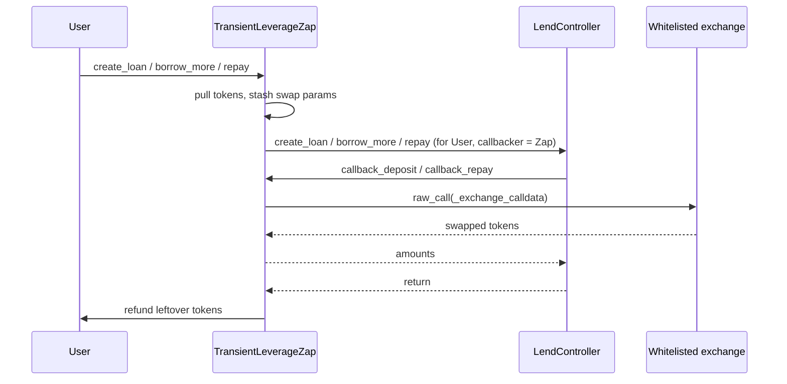

# Leverage: Overview

Llamalend v2 markets support **leveraged positions**: a user deposits some collateral, borrows the market's borrowed token, swaps the borrowed amount into more collateral and adds it to the same loan, all in one transaction. Deleveraging works the other way round. Part of the position's collateral is sold for the borrowed token, and the proceeds repay debt.

The swap is done by a **leverage zap**, a helper contract that the controller calls back during `create_loan`, `borrow_more` and `repay`. The zap routes the swap through a whitelisted exchange: the Curve router or an aggregator router such as 0x, Enso or KyberSwap.

There are two leverage zaps for Llamalend v2: the newer [`TransientLeverageZap`](./transient-leverage-zap.md) and the original [`LeverageZap`](./leverage-zap.md). This page explains how they differ, how the `TransientLeverageZap` works and what integrators need to set up. Function-level documentation is on each zap's reference page.

---

## Deployments

| Contract | Ethereum | Optimism |
| --- | --- | --- |
| [TransientLeverageZap](./transient-leverage-zap.md) | [`0xFE02…9AE2`](https://etherscan.io/address/0xFE02553d3Ba4c3f39F36a4632F91404DF94b9AE2) | [`0xA7a4…299B`](https://optimistic.etherscan.io/address/0xA7a4bb50AF91f90b6fEb3388E7f8286aF45b299B) |
| [LeverageZap](./leverage-zap.md) | [`0x5D84…b85`](https://etherscan.io/address/0x5D847c892891B503c3483D3Abbc2a23774279b85) | [`0xdbeB…584a`](https://optimistic.etherscan.io/address/0xdbeBDaE6f2D47B553B984E4091693824cf38584a) |

Each zap is bound to the Llamalend v2 [LendFactory](./lend-factory.md) on its chain and only works with markets deployed by that factory.

---

## LeverageZap vs. TransientLeverageZap

Both zaps produce the same result. They differ in **who calls the controller** and **how the swap route reaches the zap**.

| | LeverageZap | TransientLeverageZap |
| --- | --- | --- |
| Entry point | The user calls the **controller**, passing the zap as the callback target | The user calls the **zap**, which calls the controller on their behalf |
| How the swap route reaches the zap | ABI-encoded in the controller's callback `calldata` | Stored in the zap's transient storage for the duration of the call |
| Maximum swap route size | Limited by the controller's `CALLDATA_MAX_SIZE` (9,600 bytes, minus the encoded parameters) | 32,000 bytes |
| Controller approval needed | No | Yes: `controller.approve(zap, True)` |
| Exchange spending cap | None; the exchange is approved for `max_value(uint256)` during the swap | The borrowed amount (`_debt`) or `_collateral_to_spend` |
| `max_borrowable` | Uses `loan_discount` only | Also applies the user's `extra_health` and checks `_N` |

Aggregator routes regularly exceed the controller's calldata limit, which is why the `TransientLeverageZap` exists. The price is one extra approval: since the zap creates, extends and repays loans *for* the user, the user has to allow it to act for them on the controller.

---

## How the TransientLeverageZap Works

Every entry point of the `TransientLeverageZap` (`create_loan`, `borrow_more`, `repay`) follows the same pattern:

1. **Resolve the market.** The caller passes a market index (`_controller_id`), and the zap looks up the controller with `LendFactory.markets(_controller_id).controller`.
2. **Pull the user's funds.** The zap transfers collateral (for `create_loan` and `borrow_more`) or borrowed tokens (for `repay`) from the caller to itself. It has to hold them because the controller pulls them from its `msg.sender`, which is the zap.
3. **Stash.** The swap parameters (`_exchange_address`, `_exchange_calldata`, the spend cap and `_min_recv`) and the zap's current token balance are written to transient storage. While a call is in progress, the stored controller address also blocks reentry into the entry points.
4. **Call the controller** on behalf of `msg.sender`, with the zap as the callback target and empty callback `calldata`.
5. **Callback.** The controller calls `callback_deposit` or `callback_repay` on the zap. The zap checks that the caller is the controller it is currently calling, approves the exchange for at most the spend cap, executes the swap via `raw_call`, revokes the approval, checks slippage and returns the amounts to the controller.
6. **Unstash and refund.** After the controller call returns, the transient values are cleared and **all** borrowed and collateral tokens left in the zap are sent back to the caller.

### Slippage and spending limits

The zap protects the user in three ways during the swap:

- **Output check:** the swap must return at least `_min_recv` (collateral when leveraging, borrowed token when deleveraging), otherwise the transaction reverts with `"Slippage"`.
- **Input cap:** the exchange is approved for at most `_debt` borrowed tokens when leveraging, or `_collateral_to_spend` collateral when deleveraging. The approval is revoked right after the swap.
- **Funds already in the zap are excluded:** the swap output is measured against the zap's balance *before* the swap, so tokens the user parked in the zap for the controller can never be counted as swap proceeds.

---

## Integration

### Using the TransientLeverageZap

:::warning[Prerequisites]

Before calling any entry point of the `TransientLeverageZap`, the user must:

- call `approve(zap, True)` on the market's [LendController](./lend-controller.md), so the zap may create, extend or repay a loan for them;
- approve the zap to spend the **collateral token** (for `create_loan` and `borrow_more`) or the **borrowed token** (for `repay`, when `_wallet_d_debt > 0`).

:::

A typical flow to open a leveraged position:

1. **Pick a market.** Get its index in the `LendFactory` and its controller address.
2. **Get a swap route.** Request a route from the Curve router or an aggregator for swapping the amount you plan to borrow into collateral. The route must use a whitelisted exchange (see below) and **must send its output to the zap**, because the zap measures its own balance after the swap. Set the zap as the taker/sender of the swap as well, since the zap holds the borrowed tokens.
3. **Check the borrow limit.** Call [`max_borrowable`](./transient-leverage-zap.md#max_borrowable) with the user's collateral, the collateral expected from the swap, the number of bands and the swap's average price. Borrow no more than the returned amount.
4. **Approve.** Approve the zap on the controller and on the collateral token (see prerequisites).
5. **Open the position.** Call [`create_loan`](./transient-leverage-zap.md#create_loan) with the market index, collateral, debt, number of bands, the minimum collateral to receive, the exchange address and the route calldata.

Increasing leverage ([`borrow_more`](./transient-leverage-zap.md#borrow_more)) works the same way. To deleverage or close a position, request a route that swaps collateral into the borrowed token and call [`repay`](./transient-leverage-zap.md#repay). Pass `max_value(uint256)` as `_wallet_d_debt` to cover any shortfall from the wallet when closing the position completely.

### Using the LeverageZap

With the [`LeverageZap`](./leverage-zap.md), the user calls the controller directly and passes the zap as `_callbacker`. The swap parameters go into the controller's `_calldata`, ABI-encoded as `(controller_id, min_recv, exchange_address, exchange_calldata)`. No approval of the zap on the controller is needed. See [Using the Zap](./leverage-zap.md#using-the-zap) for the encoding and the matching controller calls.

---

## Exchange Whitelist

Each zap only calls exchanges on its own whitelist. The whitelists are managed by the `admin` of the `LendFactory` through `set_exchange`. Use `is_approved_exchange` to check the current state. To disable a zap entirely, the admin can remove every exchange from its whitelist.

### TransientLeverageZap

The following exchanges were added at deployment:

| Exchange | :logos-ethereum: Ethereum | :logos-optimism: Optimism |
| --- | --- | --- |
| Curve Router | [`0x4531…cd4e`](https://etherscan.io/address/0x45312ea0eFf7E09C83CBE249fa1d7598c4C8cd4e) | [`0x0DCD…d983`](https://optimistic.etherscan.io/address/0x0DCDED3545D565bA3B19E683431381007245d983) |
| `CurveRouterV2.vy` | [`0xa1C7…cb5`](https://etherscan.io/address/0xa1C7A8360EB4049595A24D6919e74e105b409cb5) | — |
| Enso Router V2 | [`0xF755…22Cf`](https://etherscan.io/address/0xF75584eF6673aD213a685a1B58Cc0330B8eA22Cf) | [`0xF755…22Cf`](https://optimistic.etherscan.io/address/0xF75584eF6673aD213a685a1B58Cc0330B8eA22Cf) |
| 0x Allowance Holder | [`0x0000…2734`](https://etherscan.io/address/0x0000000000001fF3684f28c67538d4D072C22734) | [`0x0000…2734`](https://optimistic.etherscan.io/address/0x0000000000001fF3684f28c67538d4D072C22734) |
| KyberSwap Meta Aggregation Router v2 | [`0x6131…37b5`](https://etherscan.io/address/0x6131B5fae19EA4f9D964eAc0408E4408b66337b5) | [`0x6131…37b5`](https://optimistic.etherscan.io/address/0x6131B5fae19EA4f9D964eAc0408E4408b66337b5) |

### LeverageZap

On Ethereum, the zap was deployed with four exchanges. Odos has since been removed from the whitelist:

| Exchange | Address | Approved |
| --- | --- | --- |
| Curve Router | [`0x4531…cd4e`](https://etherscan.io/address/0x45312ea0eFf7E09C83CBE249fa1d7598c4C8cd4e) | Yes |
| `CurveRouterV2.vy` | [`0xa1C7…cb5`](https://etherscan.io/address/0xa1C7A8360EB4049595A24D6919e74e105b409cb5) | Yes |
| Enso Router V2 | [`0xF755…22Cf`](https://etherscan.io/address/0xF75584eF6673aD213a685a1B58Cc0330B8eA22Cf) | Yes |
| Odos Router V3 | [`0x0D05…0D05`](https://etherscan.io/address/0x0D05a7D3448512B78fa8A9e46c4872C88C4a0D05) | No (removed) |
