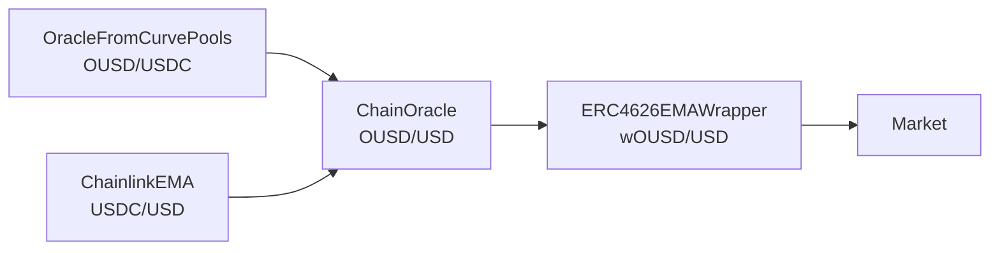

# Oracles

Every Llamalend v2 market reads the price of its collateral, denominated in the borrowed token, from an external price oracle contract. The oracle is passed to the market at creation and can later be replaced through the [`Configurator`](/developer/llamalend-v2/configurator) by calling `set_price_oracle`.

Instead of writing a bespoke oracle for every market, v2 markets are built from a small set of reusable oracle contracts. Each contract is either a **price source** (reads a price from Chainlink, a Curve pool or an ERC4626 vault) or a **wrapper** that takes another oracle as input and transforms its price (chaining, converting to USD, applying a vault share price). A market's final oracle is a stack of these contracts.

The source code for all of them can be found in the [`price_oracles/v2`](https://github.com/curvefi/curve-stablecoin/tree/master/curve_stablecoin/price_oracles/v2) folder of the `curve-stablecoin` repository. None of them is a shared singleton: a separate instance is deployed for every market that uses it.

---

## Oracle Interface

A contract can be used as a market oracle if it implements the `IPriceOracle` interface:

```vyper
@view
def price() -> uint256:
    ...

def price_w() -> uint256:
    ...
```

- `price()` returns the price of the collateral in the borrowed token, scaled to `1e18`. It is used by view functions of the AMM.
- `price_w()` returns the same price, but may also write state (e.g. persist an EMA). The AMM calls it on every exchange to update its stored oracle price.

Within a single block both functions must return the same value: the `LendFactory` asserts that `price()` and `price_w()` match when a market is created. Oracles that keep no state simply return `price()` from `price_w()`.

When a new oracle is set through the `Configurator`, it calls `price_w()` and `price()` on it to check that both are implemented, and compares the new price against the current oracle's price. The change reverts if the difference exceeds the given `_max_deviation`, unless the check is explicitly skipped (for example, when the current oracle is broken).

---

## Available Oracles

| Oracle | Type | Description | Source |
| ------ | ---- | ----------- | ------ |
| [`ChainlinkEMA`](./chainlink-ema) | Price source | Exponential moving average of a Chainlink price feed, sampled at a fixed interval. | [`ChainlinkEMA.sol`](https://github.com/curvefi/curve-stablecoin/blob/master/curve_stablecoin/price_oracles/v2/ChainlinkEMA.sol) |
| `OracleFromCurvePools` | Price source | Chains the internal `price_oracle` of one or more Curve pools into a single price. | [`OracleFromCurvePools.vy`](https://github.com/curvefi/curve-stablecoin/blob/master/curve_stablecoin/price_oracles/v2/OracleFromCurvePools.vy) |
| `CurvePoolOracle` | Price source | Prices one coin of a single Curve pool in terms of another coin of the same pool. | [`CurvePoolOracle.vy`](https://github.com/curvefi/curve-stablecoin/blob/master/curve_stablecoin/price_oracles/v2/CurvePoolOracle.vy) |
| `StableSwapNGLPOracle` | Price source | Prices the LP token of a 2-coin Stableswap-NG pool, with upward moves of the virtual price smoothed by an EMA. | [`StableSwapNGLPOracle.vy`](https://github.com/curvefi/curve-stablecoin/blob/master/curve_stablecoin/price_oracles/v2/StableSwapNGLPOracle.vy) |
| `ERC4626EMAOracle` | Price source | Prices an ERC4626 vault share in its underlying asset, with upward moves of the share price smoothed by an EMA. | [`ERC4626EMAOracle.vy`](https://github.com/curvefi/curve-stablecoin/blob/master/curve_stablecoin/price_oracles/v2/ERC4626EMAOracle.vy) |
| `ERC4626EMAWrapper` | Wrapper | Multiplies another oracle's price by an ERC4626 vault's share price, with upward moves of the share price smoothed by an EMA. | [`ERC4626EMAWrapper.vy`](https://github.com/curvefi/curve-stablecoin/blob/master/curve_stablecoin/price_oracles/v2/ERC4626EMAWrapper.vy) |
| `ChainOracle` | Wrapper | Multiplies several oracles into one price: an A/B oracle chained with a B/C oracle gives the price of A in C. | [`ChainOracle.vy`](https://github.com/curvefi/curve-stablecoin/blob/master/curve_stablecoin/price_oracles/v2/ChainOracle.vy) |
| `CrvUSDAggregatorWrapper` | Wrapper | Multiplies another oracle's price by the crvUSD/USD price from the crvUSD stable aggregator. Ethereum mainnet only. | [`CrvUSDAggregatorWrapper.vy`](https://github.com/curvefi/curve-stablecoin/blob/master/curve_stablecoin/price_oracles/v2/CrvUSDAggregatorWrapper.vy) |

---

## Example Oracle Stack

The wOUSD/crvUSD market on Ethereum prices its collateral with the following stack:



1. `OracleFromCurvePools` reads the OUSD/USDC price from the OUSD/USDC Curve pool's own EMA oracle.
2. `ChainlinkEMA` smooths the Chainlink USDC/USD feed.
3. `ChainOracle` multiplies the two into an OUSD/USD price.
4. `ERC4626EMAWrapper` multiplies that by the wOUSD share price, giving wOUSD/USD. The borrowed token, crvUSD, is counted at \$1.

The market only ever calls the top contract of the stack. `price_w()` calls propagate down through each wrapper, so every contract in the stack that keeps state is updated.
